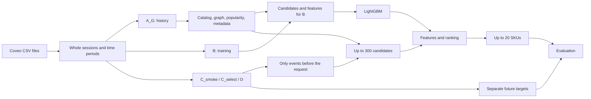

# Session-based recommendations on Coveo data

English | [Русский](/README.ru.md)

A recommender for short anonymous sessions, combining an interaction graph,
product metadata, and a LightGBM ranker. It processes raw CSV files, serves
recommendations through a local HTTP API, and evaluates them on a held-out period.

## Problem and value

What should a visitor see when all we know is their activity in the current
session? The system returns up to 20 SKUs after the first eligible event block.
The target is the set of distinct products in **recorded purchases after that
request**, within 24 hours and the same session. It is neither last-purchase
prediction nor purchase-probability estimation.

This setting needs no persistent user profile. The challenges are limited
context, sparse purchases, and products with little interaction history.
The graph captures relationships from interactions; the supplied description
and image vectors represent product similarity; the ranker combines these signals.

The project provides a verifiable experiment on real data, with temporal splits
that keep future events out of features, comparisons with simple baselines,
an analysis of where targets are lost, and a working API with fallback responses.
Business benefits remain untested: sales lift and the effect of displaying
recommendations were not measured.

The dataset is [Coveo SIGIR eCOM 2021, Public Data Release 1.0.0](https://github.com/coveooss/SIGIR-ecom-data-challenge).
The released telemetry may be incomplete. A missing
purchase record is not treated as proof that no purchase occurred.

## How it works



A_G and B each contain 50,000 sessions; the historical catalog contains 14,314 SKUs.
The main model uses 93 features and 200 trees. Sessions are sampled by hash,
independently of purchases. Candidate retrieval does not use targets.
At serving time, the same computation uses the current session state and the
trained model. See the [architecture](/documents/en/architecture.md).

## Measured results

Hit@20 is the fraction of sessions with at least one target SKU in the first
20 recommendations **among sessions with a recorded target**, not among all
sessions. Unknown targets are not counted as misses. Targets outside the
catalog remain in the denominator.

### D: final evaluation

60,000 sessions: 748 with a recorded target and 59,252 with an unknown target.

| Method | Sessions with a hit | Hit@20 |
|---|---:|---:|
| **Graph + metadata + LightGBM, 300 candidates (GCS+Rk)** | **441 / 748** | **58.96%** |
| Recent items, padded with popular items (R) | 325 / 748 | 43.45% |
| Graph + LightGBM without metadata | 376 / 748 | 50.27% |
| Popular items (P) | 2 / 748 | 0.27% |

D and the final `post_D` check are complete. The statistical conclusion is
`insufficient`: the evidence for the temporal dependence assumptions is too
weak to support a usable interval. The differences are descriptive;
they do not establish statistical superiority.

Of the main model's 307 misses, 172 sessions have no target in the historical
catalog, 106 have no target among the candidates, and 29 have no target in the
top 20. Most losses occur before ranking.

### C_select: the 370-candidate experiment

50,000 sessions: 625 with a recorded target and 49,375 with an unknown target.

| Variant | Sessions with a hit | Hit@20 | Target among candidates |
|---|---:|---:|---:|
| **300 candidates, retained** | **389 / 625** | **62.24%** | 414 / 625 = 66.24% |
| 370 candidates | 388 / 625 | 62.08% | 431 / 625 = 68.96% |

The hypothesis was that retrieving more products similar in description and
image would produce more hits. The two source quotas increased from 40/30 to
80/60; B features were recomputed, and a new model was trained with the same
parameters. Candidate coverage increased; Hit@20 did not.
The measured computation time including diagnostics increased by roughly 19%,
but the diagnostics differed: only the main model was also checked for
sensitivity to event multiplicities. The timer also included diagnostic
JSON serialization, but not the shared table writes.
This is not a like-for-like measurement of `recommend` speed, HTTP latency,
or total command runtime. The original model was retained under the selection
rule because Hit@20 did not improve.

The difference is one hit, not evidence of superiority. C_select was used
for selection **after D had been analyzed**; the earlier D result does not
independently validate that choice. Percentages from different periods must
not be interpreted as a model improvement.
Result sources and resource measurements are listed in the
[reproduction guide](/documents/en/reproduction.md#measured-costs).

## Installation and usage

Python 3.11; dependencies are pinned in [uv.lock](/uv.lock).
Run commands from the repository root. Real-data computations and the local
service were tested on Windows;
[GitHub Actions](/.github/workflows/checks.yml) runs on Ubuntu without Coveo data.

```powershell
uv sync --locked --no-extra neural --no-editable
uv run --no-sync coveo-recsys --help
uv run --no-sync ruff format --check .
uv run --no-sync ruff check .
uv run --no-sync mypy
uv run --no-sync pytest -m "not coveo and not load"
```

The full pytest suite excluding Coveo and load tests was run from a
non-editable wheel installation in a clean directory.
For local admission on Windows, only known symbolic-link test skips caused
by `WinError 1314` are allowed; they remain `skipped`. These tests are
mandatory on Ubuntu. Other rules are in
[the implementation specification, §15.1](/documents/en/implementation_spec.md#151-general-procedure).

The CSV files and trained model are not distributed in Git.
The API requires the artifacts listed in the
[local demo instructions](/documents/en/reproduction.md#local-demo).
The service configuration points to a completed local experiment.

The repository includes data checks and tools for preparing admission evidence.
The [command sequence](/documents/en/reproduction.md#full-computation-workflow)
builds a model and a C_smoke report from the three CSV files without relying
on previous runs. This small real-data workflow was verified with a separate
non-editable wheel installation;
[results and resource usage](/documents/en/reproduction.md#small-run-results)
are recorded. It reproduces the basic workflow, not the published D results;
the main model was preserved.

## Example recommendations

The service accepts a sealed event block through `POST /v1/blocks`, then
returns recommendations through `POST /v1/recommendations`.
It supports retries without recomputation, falls back on a computation timeout,
and refuses requests when state is incomplete. The request deadline is 1 s, with
100 ms reserved for fallback, persistence, and returning the response.

Excerpt from a verified response: the first 2 of 20 SKU identifiers and selected status fields.

```json
{
  "items": [
    "0005c742138a6bf913d314c829f41ff2d8e665e9b3670b7b337a9d59b7cff34d",
    "52cf0c63ee45fba1d2d76bf59639f48fcc06233c58b9fd0251d3a3013acc4a1b"
  ],
  "branch": "primary",
  "delivery": "delivered"
}
```

The [request and verified response](/documents/en/reproduction.md#local-demo)
use the trained real-data model. SKUs are anonymized; product names cannot
be recovered. The example demonstrates the API, not recommendation quality.

## Limitations

- The protocol evaluates recorded purchases. It does not measure conversion,
  all purchases, or an A/B test outcome.
- Only 625 B sessions have a target. Targets and purchases are sparse,
  and the historical catalog is incomplete.
- Metadata was released as a single snapshot; its historical availability
  is unproven. A separate variant without metadata was therefore evaluated.
- Intervals and the final statistical conclusion are marked `insufficient`.
  D has already been studied and cannot independently confirm new improvements.
- The API is local; deadline compliance under production load is unverified.
  A neural model, production deployment, and A/B testing are not implemented.
- Full computation takes hours. Checking the small workflow does not reproduce
  the full experiment. Data and models are not included in the repository.

## Future work

Possible next steps include broader catalog coverage, learned representations
based on the graph and metadata, and time-aware updates to relationships.
A sequential model is worth testing only when enough context exists before
the recommendation.
These are optional research directions, not implemented capabilities; see
[hypotheses and comparison protocols](/documents/en/development_plan.md#47-further-development).

## Documentation

- [Reproduction and demo](/documents/en/reproduction.md).
- [Architecture](/documents/en/architecture.md),
  [implementation specification](/documents/en/implementation_spec.md),
  [development plan and status](/documents/en/development_plan.md).
- Mathematical specification:
  English [PDF](/documents/en/math/coveo_session_recommender_math.pdf) /
  [LaTeX](/documents/en/math/coveo_session_recommender_math.tex);
  Russian [PDF](/documents/math/coveo_session_recommender_math.pdf) /
  [LaTeX](/documents/math/coveo_session_recommender_math.tex).
- Shared [configuration files](/configs/README.md) and
  [schemas](/schemas/README.md);
  [run manifest template](/documents/math/coveo_session_recommender_run_manifest.template.json).

[MIT](/LICENSE) applies to the project’s source code. The Coveo dataset is not
distributed with this repository and is subject to Coveo’s separate
[Terms & Conditions](https://github.com/coveooss/SIGIR-ecom-data-challenge/blob/main/Terms%20%26%20Conditions.txt).
The code license does not replace the terms for distributing derived artifacts.
