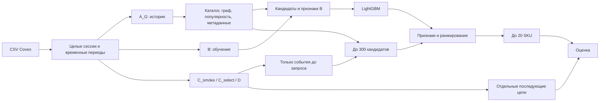

# Сессионные рекомендации на данных Coveo

Рекомендательная система для коротких анонимных сессий: граф взаимодействий,
метаданные товаров и ранжировщик LightGBM. Реализован путь от исходных CSV до
локального HTTP API и оценки на отложенном периоде.

## Задача и ценность

Какие товары предложить посетителю, если о нём известны только действия текущей
сессии? Система выдаёт до 20 SKU после первого допустимого блока событий.
Цель — различные товары из **зарегистрированных покупок после этого запроса**
в пределах 24 часов той же сессии. Это не предсказание последней покупки и не
оценка вероятности покупки.

Такой сценарий не требует постоянного профиля пользователя. Его трудности —
короткий контекст, редкие покупки и товары без достаточной истории. Граф даёт
связи по взаимодействиям, предоставленные векторы описаний и изображений —
сходство товаров, ранжировщик объединяет эти сигналы.

Ценность проекта — проверяемый эксперимент на реальных данных: временное
разделение без будущих событий в признаках, сравнение с простыми методами,
разбор потерь и работающая выдача с резервным ответом. Польза для магазина
остаётся гипотезой: рост продаж и эффект показа рекомендаций здесь не измерялись.

Используется [Coveo SIGIR eCOM 2021, Public Data Release 1.0.0](https://github.com/coveooss/SIGIR-ecom-data-challenge).
Опубликованная телеметрия не гарантирует полноту наблюдений; отсутствие записи
о покупке не считается доказанным отсутствием покупки.

## Как устроено решение



A_G и B содержат по 50 000 сессий, исторический каталог — 14 314 SKU.
В основной модели 93 признака и 200 деревьев. Сессии отбираются по хешу,
независимо от покупок. Цели не участвуют в построении кандидатов.
При обслуживании тот же расчёт использует текущее состояние сессии и готовую модель.
Подробности — в [архитектуре](/documents/architecture.md).

## Измеренные результаты

Hit@20 — доля сессий с хотя бы одним целевым SKU в первых 20 рекомендациях
**среди сессий с зарегистрированной целью**, не среди всех сессий.
Неизвестные цели не считаются промахами. Цели вне каталога остаются в знаменателе.

### D: итоговая оценка

60 000 сессий; у 748 есть зарегистрированная цель, у 59 252 она неизвестна.

| Метод | Сессии с попаданием | Hit@20 |
|---|---:|---:|
| **Граф + метаданные + LightGBM, 300 кандидатов (GCS+Rk)** | **441 / 748** | **58,96%** |
| Последние товары с дополнением популярными (R) | 325 / 748 | 43,45% |
| Граф + LightGBM без метаданных | 376 / 748 | 50,27% |
| Популярные товары (P) | 2 / 748 | 0,27% |

D и итоговая проверка `post_D` завершены. Статус статистического вывода —
`insufficient`: обоснования временной зависимости недостаточно для пригодного
интервала. Различия описательные; статистическое превосходство не заявляется.

Из 307 промахов основной модели: в 172 сессиях цель отсутствует в историческом
каталоге, в 106 — в кандидатах, в 29 — в первых 20 результатах. Главные потери
возникают до ранжирования.

### C_select: эксперимент с 370 кандидатами

50 000 сессий; у 625 есть зарегистрированная цель, у 49 375 она неизвестна.

| Вариант | Сессии с попаданием | Hit@20 | Цель есть среди кандидатов |
|---|---:|---:|---:|
| **300 кандидатов, сохранён** | **389 / 625** | **62,24%** | 414 / 625 = 66,24% |
| 370 кандидатов | 388 / 625 | 62,08% | 431 / 625 = 68,96% |

Гипотеза: больше похожих по описанию и изображению товаров даст больше попаданий.
Квоты этих источников увеличены с 40/30 до 80/60; признаки B пересчитаны,
новая модель обучена с прежними параметрами. Покрытие выросло, Hit@20 — нет.
Собственно вычисления рекомендаций стали на 19% дольше; это не задержка HTTP
и не полное время команды с общей записью. Сохранена более дешёвая исходная модель.

Разница — одно попадание, не доказательство превосходства. C_select использован
для выбора **после разбора D**; прежний D не подтверждает этот выбор независимо.
Проценты разных периодов нельзя трактовать как прирост качества одной модели.
Источники результатов и затраты — в [инструкции](/documents/reproduction.md#измеренные-затраты).

## Установка и запуск

Python 3.11, зависимости закреплены в [uv.lock](/uv.lock). Команды выполняются
из корня проекта. Реальные расчёты и локальный сервис проверены на Windows;
[GitHub Actions](/.github/workflows/checks.yml) настроен на Ubuntu без данных Coveo.

```powershell
uv sync --locked --no-extra neural --no-editable
uv run --no-sync coveo-recsys --help
uv run --no-sync ruff format --check .
uv run --no-sync ruff check .
uv run --no-sync mypy
uv run --no-sync pytest -m "not coveo and not load"
```

Проверка 11 октября 2026: Ruff и mypy прошли; pytest — 2037 успешных,
6 отказов из-за устаревших ожиданий сообщений, 8 пропусков проверок символических
ссылок. Эти ожидания ещё нужно исправить; полный набор пока не проходит.

CSV и обученная модель в Git не распространяются. Для API сначала нужны готовые
артефакты, перечисленные в [инструкции запуска](/documents/reproduction.md#локальная-демонстрация).
Существующие настройки сервиса привязаны к локальному завершённому эксперименту.

**Ограничение воспроизведения:** установка и подготовка данных доступны из
репозитория, но сборка свидетельств допуска к обучению и оценке ещё не перенесена
из локальных скриптов. Полный запуск от чистого клона до модели пока не упакован.
[Порядок расчёта и недостающие части](/documents/reproduction.md#порядок-полного-расчёта)
указаны отдельно; проверки допуска не обходятся.

## Пример рекомендаций

Сервис принимает закрытый блок событий через `POST /v1/blocks`, затем возвращает
рекомендации через `POST /v1/recommendations`. Работают повтор без пересчёта,
резерв при вычислительном тайм-ауте и отказ при неполном состоянии.
Предельное время запроса — 1 с, из него 100 мс оставлено на резерв, запись и возврат.

[Запрос и проверенный ответ](/documents/reproduction.md#локальная-демонстрация)
показаны на готовой реальной модели. SKU обезличены; названия товаров не
восстанавливаются. Пример демонстрирует API, а не заменяет оценку качества.

## Ограничения

- Протокол оценивает зарегистрированные покупки. Это не конверсия, не все покупки
  и не результат A/B-теста.
- В B только 625 сессий с целью; цели и покупки редки, исторический каталог неполон.
- Метаданные предоставлены одним снимком, их историческая доступность не доказана.
  Поэтому отдельно проверен вариант без них.
- Интервалы и итоговый статистический статус — `insufficient`. Уже исследованный D
  нельзя использовать для нового независимого подтверждения улучшений.
- API локальный; соответствие срокам под рабочей нагрузкой не подтверждено.
  Нейросетевая модель, промышленное развёртывание и A/B не реализованы.
- Полный расчёт занимает часы, а полный запуск из чистого клона требует ещё
  упаковки подготовки допусков. Данные и модель не входят в репозиторий.

## Дальнейшее развитие

Расширение покрытия каталога, обучаемые представления на графе и метаданных,
обновление связей с учётом времени. Последовательную модель стоит проверять лишь
при достаточном контексте до рекомендации. Это необязательные исследования,
не заявленные возможности; [гипотезы и способы сравнения](/documents/development_plan.md#47-дальнейшее-развитие).

## Документация

- [Воспроизведение и демонстрация](/documents/reproduction.md).
- [Архитектура](/documents/architecture.md), [ТЗ](/documents/implementation_spec.md),
  [план и состояние работ](/documents/development_plan.md).
- [Математическая спецификация: PDF](/documents/math/coveo_session_recommender_math.pdf)
  и [LaTeX](/documents/math/coveo_session_recommender_math.tex).
- [Настройки](/configs/README.md), [схемы](/schemas/README.md),
  [шаблон паспорта](/documents/math/coveo_session_recommender_run_manifest.template.json).

Данные получают самостоятельно по условиям Coveo. Лицензия собственного кода
пока не выбрана; условия использования данных и распространения производных
артефактов рассматриваются отдельно.
