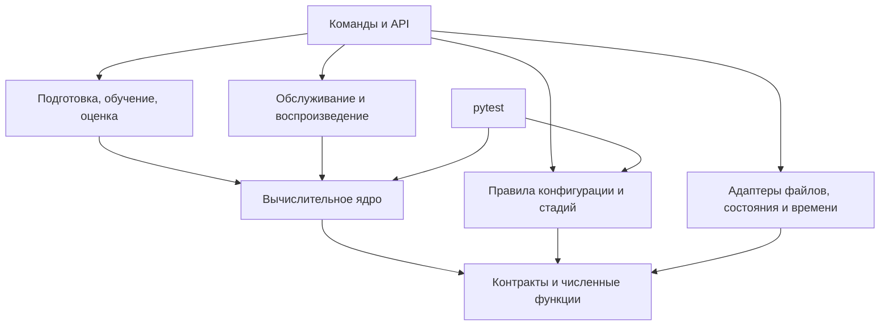

# Архитектура сессионной рекомендательной системы Coveo

Версия: 0.8. Дата: 25 сентября 2026 года. Э0 и Э1-01–Э1-09 реализованы на искусственных данных; формат поставки Coveo проверен, покрытие телеметрии неизвестно. Э1-10 и Э2–Э10 не выполнены. Проект Э2 — в §11, текущие проверки и ограничения — в [README](/README.md#проверки-и-ограничения).

## 1. Основание и границы

Основание: [ТЗ 1.5](/documents/implementation_spec.md), [математическая спецификация 2.8](/documents/math/coveo_session_recommender_math.tex) и [шаблон паспорта 2.8](/documents/math/coveo_session_recommender_run_manifest.template.json). Хеши исходников — в [ТЗ §19](/documents/implementation_spec.md#19-версия-основания), задачи и приёмка — в [плане разработки](/documents/development_plan.md). Приоритет требований задан во введении ТЗ. Особенности текущей реализации — в §10.

Основной локальный путь — данные → GCS+Rk → отчёт `C_smoke` → выбор на `C_select`, калибровка на E и итоговая оценка D. Сервис Э6 — отдельная ветвь после фиксации алгоритмических контрактов; его готовность и нагрузочная приёмка не открывают и не блокируют локальную оценку Э7. Здесь описаны программные границы; формулы, параметры и проверки остаются в ТЗ и математической спецификации.

## 2. Основные решения

- Один Python-пакет с отдельными командами и API: вычисления переиспользуются при подготовке, обучении и обслуживании.
- Чистые функции и адаптеры ввода, хранения и времени: алгоритмы проверяются без HTTP и СУБД.
- Типизированные внутренние структуры и схемы внешних данных: ошибки входа обнаруживаются до расчёта.
- Общий расчёт состояния, источников и признаков: обучение и сервис используют одинаковые преобразования.
- Неизменяемые артефакты с зависимостями: смена входов или кода обнаруживается до повторного использования результата.

Границы существующих и запланированных модулей заданы в §3. Для локального пути реализуются только необходимые вычисления, ввод и оценка; сервисные адаптеры, наблюдение и A/B относятся к своим этапам.

## 3. Границы модулей и зависимости

| Модуль | Ответственность |
|---|---|
| `contracts`, `numerics` | Структуры, единицы, статусы, порядок ID и проверяемая арифметика. Не зависят от остальных модулей. |
| `data` | Чтение CSV, канонизация, время, расписание и распределение целых сессий по периодам. Чтение отделено от преобразований. |
| `state` | Чистый `StateReducer`, доступный префикс и интерфейс хранилища с адаптерами памяти и рабочей СУБД. |
| `targets` | Зрелость, будущие цели, исходы и исторические когорты. Недоступен обслуживанию запросов. |
| `historical` | Сборка каталога, графов, статистик и векторов. Загрузчик готового пакета не импортирует сборщик. |
| `retrieval` | Источники, точные баллы, квоты, объединение, происхождения и резерв. Не использует метки и ранжировщик. |
| `features` | `FeatureEngine` по закреплённой схеме; общие функции расчёта баллов источников. Обратная зависимость `retrieval → features` запрещена. |
| `ranking`, `calibration` | Раздельные обучение и применение моделей. Применение получает готовые признаки/баллы и совместимый артефакт, не читает обучающие таблицы. |
| `serving` | Конвейер рекомендации и управление запросом: API, сроки, доступность источников, выбор ветви и обязательная запись. Транспорт отделён от вычислений. |
| `explanations` | Объяснения по расчётной опоре выбранной ветви и шаблонам пакета. Публичная форма отделена от диагностики. |
| `evaluation`, `experiments` | Сессионные метрики и интервалы; отдельно — назначения и анализ A/B. |
| `config`, `artifacts` | Конфигурация и допуск стадий; хранение и совместимость артефактов. |
| `verification` | Идентификация исполняемого кода. Тесты выполняет обычный `pytest`; соответствие ID тестам хранится как данные. |
| `monitoring`, `reporting` | Наблюдение, защитные действия и отчёты по сохранённым измерениям. |
| `cli`, `extensions` | Сборка рабочих сценариев; подключение расширений через объявленные интерфейсы и конфигурацию. |

Стрелка означает зависимость от используемого компонента. Ядро включает чистые части обработки данных, состояния, отбора, признаков, моделей и объяснений.

Адаптеры передаются через интерфейсы. Ядро не импортирует HTTP, СУБД, `cli` и часы процесса. Проверка стадии читает сведения об артефактах и результатах, но не запускает обучение или тесты.

Сценарий в `cli` или API передаёт канонический блок в `StateReducer`, затем префикс — в функции расписания; зависимости `data → state` нет. Применение моделей не импортирует обучение. Доступ сервиса к хранилищам будущих целей закрыт.

Основание: [ТЗ §§2.1–2.3](/documents/implementation_spec.md#2-архитектура-и-общие-требования), [§14](/documents/implementation_spec.md#14-команды-и-поведение-конвейера); `sec:operations-features`, `sec:eval-maturity`.

## 4. Основные контракты

Поля и сигнатуры заданы в [ТЗ §§3.2](/documents/implementation_spec.md#32-логические-структуры) и [2.3](/documents/implementation_spec.md#23-главные-интерфейсы-ядра). Дополнительные решения:

| Контракт | Передача и ограничения |
|---|---|
| `CanonicalBlock` | Канонизация → состояние и подготовка. Целая одновременная группа с кратностями, причинами непригодности поиска и происхождением; завершённость исторической группы не заменяет подтверждение рабочего конверта. |
| `PrefixSnapshot`, `PreparedRequest`, `RequestContext` | Состояние → расписание, отбор и признаки. Подготовленный запрос не требует ещё не построенного каталога. `RequestContext` добавляет его хеш при применении. Текущая запись с более поздними событиями не заменяет срез; будущее число запросов и исход не входят в контекст. |
| `TargetRecord`, `SupervisionRecord` | Подготовка целей и весов → обучение/оценка. Отдельные наборы присоединяются к признакам по `request_id` только в пакетном сценарии. |
| `HistoricalPackage` | Сборщик → отбор и признаки. Набор из A_G без ранжировщика, достаточный для построения таблицы B. |
| Результат источника, `CandidateResult` | Источники → объединение, признаки и объяснения. Список после квоты, измеримый балл, ранг, доступность и опора хранятся отдельно; неизмеренный список не считается пустым. |
| `FeatureBatch` | Расчёт признаков → ранжировщик. Порядок SKU/столбцов и хеш схемы проверяются вместе с моделью; метки и веса хранятся отдельно. |
| Пакет рекомендации | Хранилище артефактов → запрос. Состав — по §10.4 ТЗ. При разрешённом режиме калибратор может отсутствовать или быть непригодным; причина сохраняется. |
| `StateTransition` | `StateReducer` → хранилище. Расчёт перехода отделён от атомарного сравнения версии и записи событий, квитанции, состояния и полноты. Конфликт возвращается вызывающему сценарию. |
| `execution_context`, `RequestResult` | Координатор → конвейер и учёт. Остаточный срок и доступность источников задаются явно; выбранная ветвь, кандидаты и доставка фиксируются раздельно. |

Ошибки обязательного входа, пропуски модальностей и внутренняя неконечность имеют разные причины. Ранние структуры определены в `src/coveo_recsys/contracts/`; цели и веса вынесены в `contracts.training` и не импортируются контрактами обслуживания.

## 5. Путь данных при подготовке, обучении и оценке

1. Порционное чтение → канонические блоки → префиксы и расписание → допуск, периоды и подвыборка. Цели сохраняются отдельно.
2. Допустимые полностью наблюдённые сессии A_G → `HistoricalPackage`. Данные последующих периодов не пополняют замороженный пакет; A_N в базе зарезервирован.
3. Запросы B → общий отбор → `FeatureEngine` → присоединение целей и сессионных весов → обучение ранжировщика. Пустые запросы остаются в исходном расписании.
4. Обученный ранжировщик → пакет для последующих запросов. Опора калибровки на B готовится к расчётам E; она не является независимой оценкой.
5. `post_training` → `ideal_deterministic` на C_smoke → присоединение зрелых целей → сессионные метрики → машинный и читаемый отчёты.
6. По зафиксированному плану: C_select → калибратор выбранного варианта на E → итоговая оценка D. Калибровочный код и вариант без метаданных готовятся к соответствующим расчётам E/D. Чувствительность без метаданных обязательна к D: у варианта собственные признаки, ранжировщик и, при достаточных данных, калибратор.

Проверки формата закрытых периодов разрешены отдельно от доступа к исходам и показателям качества. Разделение обеспечивают права чтения, маршрутизация наборов и журнал доступа.

Основание: [ТЗ §§5–9](/documents/implementation_spec.md#5-подготовка-событий-запросов-и-целей), [§14](/documents/implementation_spec.md#14-команды-и-поведение-конвейера); `sec:eval-periods`, `sec:eval-stages`, `sec:metadata-sensitivity`.

## 6. Путь данных при обслуживании

Эта ветвь реализуется в Э6 и принимается перед рабочим обслуживанием и пилотом. Она использует те же алгоритмы, что и локальный путь.

1. Адаптер проверяет отправителя, лимиты, полный `sealed_block_v1` и повторы. Канонизация и `StateReducer` рассчитывают переход; хранилище атомарно подтверждает его. Серверное время принятия становится временем доступности новых событий.
2. Сценарий проверяет расписание и идемпотентность, получает `PrefixSnapshot` и совместимый пакет. При объединённом маршруте a_q фиксируется после атомарного принятия блока; общий срок — от первого байта.
3. Конвейер готовит резерв, выполняет отбор, признаки и ранжирование в оставшееся время. Координатор выбирает ветвь; префикс и пакет закреплены за запросом.
4. Объяснения, обязательная запись и публичный ответ завершают запрос. Кандидаты выбранной ветви, доставка и причины фиксируются в учёте. Ошибка ответа не отменяет принятые события.

При недоставке после выбора ветви её кандидаты сохраняются, доставленный список пуст. До выбора готовой ветви пусты оба множества. Резерв использует собственные происхождения и объяснения, без основного ранжировщика.

Восстановление из контрольной точки использует тот же `StateReducer`. Режим `execution_trace` повторяет записанные версии, доступность, ветвь и доставку; исправный повтор расчёта не восстанавливает отсутствующую трассу.

Основание: [ТЗ §10](/documents/implementation_spec.md#10-сервис-состояние-и-версии), [§9.3](/documents/implementation_spec.md#93-режим-воспроизведения); `sec:ops-transport-block`, `sec:ops-state-storage`, `sec:ops-replay-trace`, `sec:ops-deadlines`.

## 7. Версии и зависимости артефактов

Каталог запуска — по [ТЗ §3.3](/documents/implementation_spec.md#33-каталог-запуска). Первая реализация хранения — локальные файлы: Parquet для таблиц, массивы с явными типами, формой и порядком ID для матриц. Библиотеки и кодеки закрепляются в Э0.

| Идентификатор | Назначение |
|---|---|
| Версия схемы | Правило чтения структуры. |
| SHA-256 артефакта | Хеш точных байтов; описание содержит зависимости от входов, конфигурации и кода. |
| `run_id`, `config_id` | Запуск и зарегистрированный вариант; не заменяют проверку хешей. |
| `package_id` | Идентификатор неизменяемого состава пакета. |
| Версии состояния и префикса | Атомарное обновление и восстановление среза. Ключ кэша также включает t_q и пакет. |
| Паспорт запуска | Один файл с закреплёнными входами, кодом, настройками и планами; результаты расчётов и тестов сохраняются отдельно. |

До вычислений закрепляются входы, код, схемы и настройки; планы оценки фиксируются до доступа к соответствующим оценочным данным. Отдельные результаты ссылаются на запуск, его настройки и проверенные входы. Обязательных снимков паспорта по стадиям, отдельных файлов его контрольных сумм и универсального реестра артефактов нет. Результаты запуска исключаются из области хеширования кода.

Публикация: промежуточная запись → проверка → неизменяемый файл. Повторное использование требует совпадения входных хешей, конфигурации и кода.

| Изменение | Пересборка и повторные проверки |
|---|---|
| Канонизация, расписание, периоды или состав сессий | Затронутые наборы, исторический пакет, признаки, модели и оценки. |
| Исторический пакет, отбор, кодировщик, квоты или схема признаков | Кандидаты и признаки B, ранжировщик, опора B, калибратор, пакет и затронутые проверки. |
| Ранжировщик | Опора B, калибратор, пакет, выдача и оценки. |
| Шаблоны объяснений | Пакет, EXPL01 и затронутые испытания обслуживания; без переобучения ранжировщика. |
| Оформление отчёта | Читаемый отчёт из прежних машинных результатов. |

Время сборки отличается от времени публикации. Запрос выбирает последнюю совместимую публикацию строго до t_q, не до a_q, и закрепляет её до завершения. Смена схемы состояния требует проверенной миграции либо восстановления.

Пакет загружается без исполнения сериализованного кода, с проверкой путей, размеров, типов и совместимости. Для рабочего сервиса обязательны подпись по отдельно доверенному ключу, владельцы, контроль доступа и проверяемое удаление данных, состояния, журналов и копий по установленным срокам. Эти требования принимаются в Э6 и перед пилотом. Хеш удалённого входа не позволяет его воспроизвести.

Основание: [ТЗ §§10.3–10.4](/documents/implementation_spec.md#103-состояние-и-переходы), [§11.2](/documents/implementation_spec.md#112-доступ-и-сроки); `sec:eval-snapshots`, `sec:ops-security`, `sec:freshness-publication`.

## 8. Управление конфигурацией и приёмкой

Проверка паспорта: JSON Schema → смысловые связи → условия стадии и её артефакты. Модули получают проверенную конфигурацию своей части, без общего изменяемого JSON.

`config` проверяет обязательные к текущему шагу поля, результаты и неизменность закреплённых планов. Флаг в паспорте сам по себе не доказывает прохождение проверки или фиксацию плана.

`manifest init` создаёт `manifest.json` в каталоге запуска. `manifest validate` принимает внешние закреплённые хеши планов через `--plan-reference NAME=SHA256`: `before_C_select`, `before_E`, `before_D`, `before_AB` к их срокам. `--operation calibrate` проверяет готовность к расчётам E, `--operation evaluate` — применимые проверки оценки, включая B12. Эти режимы проверяют допуск, но не выполняют расчёт; будущие команды до реализации возвращают отказ.

Проверки выполняются через `pytest`; ID требований связываются с тестами и их результатами. Эталоны независимы от проверяемых функций. Хеш и снимок каждого теста и его предварительная регистрация отдельным артефактом не обязательны. Части B03, B05, B10 и X02 учитываются отдельно; статус целого ID определяется всеми применимыми частями к их сроку. Статусы тестов, системы, калибровки и метрик хранятся раздельно.

Приёмка кода на искусственных данных и реальный `preflight` разделены в [Э1-10 плана](/documents/development_plan.md#э1-10-допуск-первого-реального-запуска). Порядок открытия периодов и проверки до C_smoke — в [§5 плана](/documents/development_plan.md#5-контрольные-точки-запуска). План точности нужен до обучения, окончательная сетка и блоки — до D (`sec:eval-precision`, `sec:eval-time-block`).

Основание: [ТЗ §4](/documents/implementation_spec.md#4-паспорт-запуска-и-управление-этапами), [§15](/documents/implementation_spec.md#15-тестирование-и-прослеживаемость), [§17.2](/documents/implementation_spec.md#172-раздельные-решения); `app:run-manifest`, `app:run-stages`, `app:tests-normative`, `sec:acceptance`.

## 9. Решения по мере реализации

| Решение | Срок и результат |
|---|---|
| Среда | Э0: CPython 3.11.9, зависимости и хеши в `uv.lock`, состав — в `pyproject.toml`. Нейросетевой профиль устанавливается отдельно. |
| Фактические входы | Формат и локальные хеши поставки проверены; покрытие неизвестно. Следом — адаптер подготовки, свидетельство покрытия и, после готовности обязательного кода Э3–Э4, Э1-10 с реальным `preflight`. |
| Признаки | Э3, до реального `preflight` и обучения: раскладка столбцов, преобразования и хеш схемы. |
| План оценки | По срокам §18 ТЗ: даты, объёмы, сетка и допущения по разрешённым ранним данным, без использования результатов D. |
| Рабочее хранилище состояния | Э6: выбор СУБД, адаптеры, проверка конкурентных обновлений, отказов и восстановления. |
| Нагрузка и публикация | До испытаний: процессы, потоки и измеритель памяти; до рабочего профиля — доверенные ключи, владельцы и сроки. |
| Расширения | Э8–Э9 после диагностики базы: зарегистрированный вопрос, собственные артефакты и проверки. |
| Рабочий A/B | Э10: протокол, раздельный учёт назначений/показов/исходов, эксплуатационный допуск и ответственные. |

Основание сроков — [ТЗ §18](/documents/implementation_spec.md#18-что-требуется-уточнить-до-соответствующих-этапов). Решения и их причины фиксируются здесь; ход работ и результаты — в плане разработки.

## 10. Текущая реализация

### 10.1. Контракты и хранение

- Контракты версии 2 — неизменяемые `dataclass` с вложенными кортежами. JSON-кодек сохраняет int64, исходные UTF-8 ID и `null`; неизвестные поля и версии отклоняются. Схемы записей строятся из типов, смысловые ограничения проверяются конструкторами; канонизация выполняется отдельно. Записи другой версии требуют повторной подготовки из исходных данных.
- Локальная публикация использует временный файл на том же томе, проверку и создание ссылки без перезаписи. Дескриптор отмечает завершённый артефакт; незавершённая запись не читается как готовая.
- Матрицы хранятся в NPY без объектов и `pickle`. Канонические блоки, запросы, цели и когорта — отдельные Parquet-таблицы; префиксы и цели находятся в разных каталогах. Колонка `record_json: binary` сохраняет вложенные типы в строгом конверте, JSON Schema которого публикуется отдельной зависимостью. Столбцовая раскладка для обучения — решение Э3.
- Хеш кода строится по явному перечню исходников, тестов, схем, конфигураций, зависимостей и правил упаковки `.gitignore`. Хеши нормативных документов сохраняются отдельно; редакторские правки документации не меняют хеш кода. `/data/` исключает только исходные данные в корне; модули `src/coveo_recsys/data/` входят в Git и wheel. Состав пакета проверяется чистой установкой вне каталога исходников.

`coveo-recsys environment` фиксирует версии, сборку Python, компилятор и BLAS разработческой среды; нагрузочный узел измеряется отдельно. Сборщик закреплён вместе с библиотеками, базовая установка не включает PyTorch.

### 10.2. Подготовка данных

- `RawEvent.transport_id` — подтверждённый ID доставки; технический `event_id` без него не доказывает повтор. Ключ сессии включает пространство источника. Ссылки на строки сохраняют хеш точного CSV: перестановка строк меняет происхождение, но не семантический результат.
- Двухпроходная внешняя сортировка проверяет повторы доставки и формирует целые одновременные блоки без предположения об исходном порядке CSV. Ограничения порции и группы явные; превышение даёт отказ, не усечение.
- Поздний блок требует повторного расчёта `reduce_state` из полного журнала. Ограничения хвостов не удаляют начало истории, полные счётчики и последнюю detail-группу.
- `Coverage` — отдельное свидетельство, не вывод из конца CSV. Допуск A_G требует зрелого целевого окна и завершённой сессии; длинная сессия B может иметь зрелое окно без окончательного закрытия.
- [Профиль CSV](/configs/synthetic_csv.json) и [план подготовки](/configs/synthetic_preparation.json) предназначены для искусственных данных. `PreparationPlan` версии 2 отделён от паспорта запуска 2.8 и фиксирует семь частей, размеры подвыборок, seed и ресурсные ограничения до просмотра исходов. Сценарий `cli/preparation.py` не требует будущего каталога или модели и не разрешает реальный запуск.
- `data inspect-supply` использует отдельный проверяющий читатель с [профилем поставки](/configs/coveo_supply_v1.json) и хранилище артефактов. Он не вызывает искусственный `Preparation`, не создаёт канонические события и не копирует исходные CSV в `.objects/`. Перед публикацией после сканирования заново хешируются входы, профиль и код. Проверка формата трёх CSV не открывает `data prepare` или `preflight` без свидетельства покрытия.
- Статический `validate_sealed_block` проверяет точные байты массива событий, поля и время. Его успех не является квитанцией приёма; аутентификация, повторы, атомарная запись и рабочие ограничения сессии относятся к Э6.

### 10.3. Повтор, проверки и доступ

Контрольные точки — каталог входов, канонические таблицы с индексом, реестр сессий, выборка и итоговые наборы. Завершённый повтор проверяет всю цепочку зависимостей; незавершённый возобновляется с канонического индекса. Журнал времени, объёма и пика памяти процесса не входит в детерминированный результат.

Кеш проверки действует в пределах одной операции: неизменяемые пары «путь — хеш дескриптора» и множество полностью проверенных зависимостей, без содержимого таблиц. Перед успешным возвратом заново проверяются использованные и созданные артефакты, дескрипторы и объектные копии, затем внешние входы, профиль, план и код. Кеш очищается при отказе и успехе. Это не атомарный снимок файловой системы при произвольной конкурентной записи.

`DatasetAccess` проверяет цель чтения, период, тип, схему и происхождение набора; каждая попытка журналируется. Обычный маршрут читает только A_G/B/C_smoke и не позволяет подать таблицу целей как префиксы. Владелец локальных файлов имеет прямой доступ; разграничение прав рабочей системы относится к Э6.

Расходы канонизации полного Coveo ещё не измерены; проверка структуры CSV их не подтверждает. Укрупнение таблиц требует отдельного испытания подготовки.

## 11. Проект исторического пакета Э2

Этот раздел задаёт будущие границы и форматы. Он не подтверждает реализацию `historical build` или прохождение B04. Порядок разработки и будущие тесты — в [плане Э2](/documents/development_plan.md#41-э2-исторический-пакет).

### 11.1. Входы, модули и контракты

Сборка использует полные канонические журналы выбранных допустимых сессий A_G, а не ограниченные истории запросов. Каталог определяется событиями по `eq:request-catalog`, не наличием метаданных или просмотром. Когорта первого просмотра уже рассчитана в Э1; повторная реализация её временных правил в `historical` не нужна.

Будущие контракты размещаются в `/src/coveo_recsys/contracts/historical.py`. Они не импортируют сборщик и содержат:

| Контракт | Содержание и граница |
|---|---|
| `HistoricalInput` | Повторно читаемый набор полных сессий A_G, записей допуска и когорт; хеши выборки, плана, покрытия, схем и канонических таблиц. Доступ только через проверяющий адаптер. |
| `HistoricalConfig` | Разрешённая конфигурация из паспорта, время снимка, порядок ID, версии алгоритмов и ресурсные пределы. Искусственный профиль не выдаётся за реальный допуск. |
| `MetadataSource` | Закреплённая поставка метаданных, размеры и происхождение пространств. Схема чтения и свидетельство совместимости query/text передаются явно. |
| `HistoricalPackage` | Неизменяемые ссылки на каталог, графы, статистики, словари и модальности с их версиями и хешами; без модели, целей B и исходов последующих периодов. |

Текущий `DatasetAccess` обслуживает префиксы и цели; его нельзя использовать как универсальное разрешение на чтение канонических таблиц. Новый адаптер `/src/coveo_recsys/data/historical.py` сверяет выборку с реестром сессий, допускает только A_G, проверяет происхождение и журналирует чтение. Подмена периода строкой в пути или чужой `CohortRecord` не должна менять состав входа. Проверка схемы всей поставки остаётся отдельным маршрутом.

| Будущий модуль | Ответственность и разрешённые зависимости |
|---|---|
| `historical/catalog.py` | Каталог и общий порядок строк; `contracts`, без чтения CSV. |
| `historical/graph.py` | Вклады сессий и итоговые разрежённые отношения; `contracts`, `numerics`. |
| `historical/statistics.py` | Раздельные счётчики и агрегация принятых когорт; `contracts`, `numerics`. |
| `historical/content.py` | Модальности, маски, причины непригодности и словари; `contracts`, общая нормировка `numerics`. |
| `historical/build.py` | `build_historical(admitted_A_G, metadata, config)`; соединяет вычисления, не решает вопрос допуска команды. |
| `historical/load.py` | Проверка и чтение готового `HistoricalPackage`; `contracts`, `artifacts`. Не импортирует сборщик, `targets` или `cli`. |
| `cli/historical.py` | Допуск, адаптеры входов, контрольные точки, публикация и отчёт; вычислительные правила остаются в модулях выше. |

Поток сборки: `проверенный вход A_G → каталог → граф / статистики / модальности → проверка согласованности → состав пакета`. После фиксации контрактов и каталога три средние ветви независимы. Загрузчик передаёт пакет будущим `retrieval` и `features`; обратных зависимостей нет.

Метаданные SKU вне I_G могут понадобиться для уже наблюдаемого неизвестного товара в префиксе (`sec:model-content`). Для них предусматривается отдельное чтение из той же закреплённой поставки: без расширения каталога кандидатов, исторических счётчиков или словаря категорий A_G. Предоставленные векторы сохраняют оговорку о статических метаданных (`ass:static-content`).

### 11.2. Артефакты и версии

Предлагаемый формат пакета — `historical_package_v1`, независимый от версии 2 записей Э1 и версии паспорта. Точная схема фиксируется в Э2-01 до параллельной разработки. Неизвестная версия отклоняется; изменение раскладки не сопровождается молчаливым чтением старых файлов.

Все пути таблицы ниже — внутри `/runs/<run_id>/historical/`:

| Артефакт | Представление и зависимости |
|---|---|
| `catalog.parquet` | Исходные UTF-8 SKU и индекс строки в закреплённом порядке; зависит только от принятого входа A_G. |
| `graph/<relation>/` | Разрежённые строки: смещения, индексы соседей, W, P и поддержки; отдельные d и ρ по строкам. NPY без объектов; FP64 и проверяемые целые счётчики. Все массивы связываются с одним хешем каталога. |
| `statistics.parquet`, `statistics_summary.json` | Раздельные счётчики просмотров и покупающих сессий, V/B когорты, частоты, маски и общая поддержка; зависят от A_G и версии когорты Э1. |
| `content/<modality>/`, `dictionaries.json` | Раздельные матрицы и маски/причины, категории и порядковые ценовые группы. Хеши каталога, метаданных, схемы пространств и численных правил обязательны. |
| `package.json` | Состав, версии, размеры, формы, порядок ID, момент исторического среза, хеши частей и ссылка на закреплённые входы/настройки/код запуска. Публикуется последним и не ссылается на будущие результаты. |
| `build_report.json` | Исключения, пригодность частей, объёмы и измерения ресурсов. Не входит в расчёт идентичности математических таблиц. |

Состав и зависимости частей проверяются при загрузке, включая соответствие порядка SKU во всех таблицах. Повтор использует только полностью опубликованные совместимые части. Незавершённая сборка не выдаёт готовый пакет. Версии конфигурации, кодеков и схем хешируются по [§7](/documents/architecture.md#7-версии-и-зависимости-артефактов); запись `package_id` не заменяет эту проверку.

### 11.3. Стоимость и отложенные решения

Граф строится без матрицы I_G×I_G. Рабочее представление вклада сессии — минимальная допустимая задержка пары; промежуточные записи упорядочиваются и объединяются порциями на диске. Число сохранённых соседей не ограничивает размер промежуточной агрегации: отдельно учитываются число пар, наибольшая одновременная группа, память и временный диск. При превышении объявленного предела — отказ с причиной, без усечения группы или изменения правил графа.

Для обычной конфигурации используются FP64 и устойчивые примитивы Э0. Для затухания вне представимого диапазона проектируется явный численный отказ, сохраняющий различие между существованием пары и машинным нулём; альтернативное логарифмическое хранение можно вводить отдельной версией после проверки B04. Это не меняет начальное τ_G.

Проверка поставки подтвердила размерность 50 для поиска, описаний и изображений и их формат; совместимость поиска с описанием следует из заявления издателя, а не равенства размерностей. Непрерывность телеметрии и историческая доступность метаданных не подтверждены. Расходы проверки CSV измерены, но память и диск реальной подготовки и Э2 ещё нет. Размер частей графа и матриц выбирается на отдельном испытании. `preflight` остаётся независимым шагом [плана](/documents/development_plan.md#э1-10-допуск-первого-реального-запуска).

Параллельное построение по процессам, дополнительные форматы хранения и индексы поиска можно отложить: они не нужны для проверки формул и модульных границ. Точные кандидаты и признаки — Э3; обучение — Э4; подписи, рабочие права доступа и конкурентная публикация — Э6. До реализации команда `historical build` сохраняет явный отказ.
