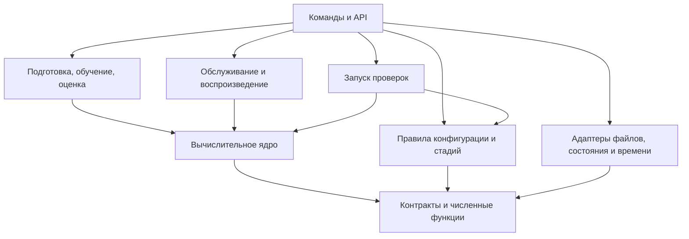

# Архитектура сессионной рекомендательной системы Coveo

Версия: 0.2. Дата: 23 сентября 2026 года. Статус: до реализации.

## 1. Основание и границы

Основание: [ТЗ 1.3](implementation_spec.md), [математическая спецификация 2.7](math/coveo_session_recommender_math.tex) и [шаблон паспорта 2.7](math/coveo_session_recommender_run_manifest.template.json). Хеши исходников — в [ТЗ §19](implementation_spec.md#19-версия-основания), задачи и приёмка — в [плане разработки](development_plan.md). Приоритет требований задан во введении ТЗ.

Первая поставка — GCS+Rk и отчёт `C_smoke`. Здесь описаны программные решения; формулы, параметры и проверки остаются в ТЗ и математической спецификации.

## 2. Основные решения

- Один Python-пакет с отдельными командами и API: вычисления переиспользуются при подготовке, обучении и обслуживании.
- Чистые функции и адаптеры ввода, хранения и времени: алгоритмы проверяются без HTTP и СУБД.
- Типизированные внутренние структуры и схемы внешних данных: ошибки входа обнаруживаются до расчёта.
- Общий расчёт состояния, источников и признаков: обучение и сервис используют одинаковые преобразования.
- Неизменяемые артефакты с зависимостями: смена входов или кода обнаруживается до повторного использования результата.

Структура пакета — по [ТЗ §2.1](implementation_spec.md#21-разделение-кода). Дополнительно выделяются `numerics` для численных функций и `verification` для регистрации и запуска проверок.

## 3. Границы модулей и зависимости

| Модуль | Ответственность |
|---|---|
| `contracts`, `numerics` | Структуры, единицы, статусы, порядок ID и проверяемая арифметика. Не зависят от остальных модулей. |
| `data` | Чтение CSV, канонизация, время, расписание и распределение целых сессий по периодам. Чтение отделено от преобразований. |
| `state` | Чистый `StateReducer`, доступный префикс и интерфейс хранилища с адаптерами памяти и рабочей СУБД. |
| `targets` | Зрелость, будущие цели, исходы и исторические когорты. Недоступен обслуживанию запросов. |
| `historical` | Сборка каталога, графов, статистик и векторов. Загрузчик готового пакета не импортирует сборщик. |
| `retrieval` | Источники, точные баллы, квоты, объединение, происхождения и резерв. Не использует метки и ранжировщик. |
| `features` | `FeatureEngine` по закреплённой схеме; общие функции расчёта баллов источников. Обратная зависимость `retrieval → features` запрещена. |
| `ranking`, `calibration` | Раздельные обучение и применение моделей. Применение получает готовые признаки/баллы и совместимый артефакт, не читает обучающие таблицы. |
| `serving` | Конвейер рекомендации и управление запросом: API, сроки, доступность источников, выбор ветви и обязательная запись. Транспорт отделён от вычислений. |
| `explanations` | Объяснения по расчётной опоре выбранной ветви и шаблонам пакета. Публичная форма отделена от диагностики. |
| `evaluation`, `experiments` | Сессионные метрики и интервалы; отдельно — назначения и анализ A/B. |
| `config`, `artifacts`, `verification` | Конфигурация и допуск стадий; хранение и совместимость артефактов; регистрация и выполнение проверок. |
| `monitoring`, `reporting` | Наблюдение, защитные действия и отчёты по сохранённым измерениям. |
| `cli`, `extensions` | Сборка рабочих сценариев; подключение расширений через объявленные интерфейсы и конфигурацию. |

Стрелка означает зависимость от используемого компонента. Ядро включает чистые части обработки данных, состояния, отбора, признаков, моделей и объяснений.

Адаптеры передаются через интерфейсы. Ядро не импортирует HTTP, СУБД, `cli` и часы процесса. Проверка стадии читает сведения об артефактах и результатах, но не запускает обучение или тесты.

Сценарий в `cli` или API передаёт канонический блок в `StateReducer`, затем префикс — в функции расписания; зависимости `data → state` нет. Применение моделей не импортирует обучение. Доступ сервиса к хранилищам будущих целей закрыт.

Основание: [ТЗ §§2.1–2.3](implementation_spec.md#2-архитектура-и-общие-требования), [§14](implementation_spec.md#14-команды-и-поведение-конвейера); `sec:operations-features`, `sec:eval-maturity`.

## 4. Основные контракты

Поля и сигнатуры заданы в [ТЗ §§3.2](implementation_spec.md#32-логические-структуры) и [2.3](implementation_spec.md#23-главные-интерфейсы-ядра). Дополнительные решения:

| Контракт | Передача и ограничения |
|---|---|
| `CanonicalBlock` | Канонизация → состояние и подготовка. Целая одновременная группа с кратностями, причинами непригодности поиска и происхождением; завершённость исторической группы не заменяет подтверждение рабочего конверта. |
| `PrefixSnapshot`, `RequestContext` | Состояние → расписание, отбор и признаки. `PrefixSnapshot` — проектное имя неизменяемого видимого среза с версией и отсечениями времени. Текущая запись с более поздними событиями не заменяет срез; будущее число запросов и исход не входят в контекст. |
| `TargetRecord`, `SupervisionRecord` | Подготовка целей и весов → обучение/оценка. Отдельные наборы присоединяются к признакам по `request_id` только в пакетном сценарии. |
| `HistoricalPackage` | Сборщик → отбор и признаки. Набор из A_G без ранжировщика, достаточный для построения таблицы B. |
| Результат источника, `CandidateResult` | Источники → объединение, признаки и объяснения. Список после квоты, измеримый балл, ранг, доступность и опора хранятся отдельно; неизмеренный список не считается пустым. |
| `FeatureBatch` | Расчёт признаков → ранжировщик. Порядок SKU/столбцов и хеш схемы проверяются вместе с моделью; метки и веса хранятся отдельно. |
| Пакет рекомендации | Хранилище артефактов → запрос. Состав — по §10.4 ТЗ. При разрешённом режиме калибратор может отсутствовать или быть непригодным; причина сохраняется. |
| `StateTransition` | `StateReducer` → хранилище. Расчёт перехода отделён от атомарного сравнения версии и записи событий, квитанции, состояния и полноты. Конфликт возвращается вызывающему сценарию. |
| `execution_context`, `RequestResult` | Координатор → конвейер и учёт. Остаточный срок и доступность источников задаются явно; выбранная ветвь, кандидаты и доставка фиксируются раздельно. |

Ошибки обязательного входа, пропуски модальностей и внутренняя неконечность имеют разные причины. Новые внутренние структуры оформляются в Э0.

## 5. Путь данных при подготовке, обучении и оценке

1. Порционное чтение → канонические блоки → префиксы и расписание → допуск, периоды и подвыборка. Цели сохраняются отдельно.
2. Допустимые полностью наблюдённые сессии A_G → `HistoricalPackage`. Данные последующих периодов не пополняют замороженный пакет; A_N в базе зарезервирован.
3. Запросы B → общий отбор → `FeatureEngine` → присоединение целей и сессионных весов → обучение ранжировщика. Пустые запросы остаются в исходном расписании.
4. Обученный ранжировщик → опора калибровки на B → пакет для последующих запросов. Расчёт опоры на обучающем B не является независимой оценкой.
5. `post_training` → `ideal_deterministic` на C_smoke → присоединение зрелых целей → сессионные метрики → машинный и читаемый отчёты.
6. По зафиксированному плану: C_select → калибратор выбранного варианта на E → итоговая оценка D. Вариант без метаданных имеет собственные признаки, ранжировщик и, при достаточных данных, калибратор.

Проверки формата закрытых периодов разрешены отдельно от доступа к исходам и показателям качества. Разделение обеспечивают права чтения, маршрутизация наборов и журнал доступа.

Основание: [ТЗ §§5–9](implementation_spec.md#5-подготовка-событий-запросов-и-целей), [§14](implementation_spec.md#14-команды-и-поведение-конвейера); `sec:eval-periods`, `sec:eval-stages`, `sec:metadata-sensitivity`.

## 6. Путь данных при обслуживании

1. Адаптер проверяет отправителя, лимиты, полный `sealed_block_v1` и повторы. Канонизация и `StateReducer` рассчитывают переход; хранилище атомарно подтверждает его. Серверное время принятия становится временем доступности новых событий.
2. Сценарий проверяет расписание и идемпотентность, получает `PrefixSnapshot` и совместимый пакет. При объединённом маршруте a_q фиксируется после атомарного принятия блока; общий срок — от первого байта.
3. Конвейер готовит резерв, выполняет отбор, признаки и ранжирование в оставшееся время. Координатор выбирает ветвь; префикс и пакет закреплены за запросом.
4. Объяснения, обязательная запись и публичный ответ завершают запрос. Кандидаты выбранной ветви, доставка и причины фиксируются в учёте. Ошибка ответа не отменяет принятые события.

При недоставке после выбора ветви её кандидаты сохраняются, доставленный список пуст. До выбора готовой ветви пусты оба множества. Резерв использует собственные происхождения и объяснения, без основного ранжировщика.

Восстановление из контрольной точки использует тот же `StateReducer`. Режим `execution_trace` повторяет записанные версии, доступность, ветвь и доставку; исправный повтор расчёта не восстанавливает отсутствующую трассу.

Основание: [ТЗ §10](implementation_spec.md#10-сервис-состояние-и-версии), [§9.3](implementation_spec.md#93-режим-воспроизведения); `sec:ops-transport-block`, `sec:ops-state-storage`, `sec:ops-replay-trace`, `sec:ops-deadlines`.

## 7. Версии и зависимости артефактов

Каталог запуска — по [ТЗ §3.3](implementation_spec.md#33-каталог-запуска). Первая реализация хранения — локальные файлы: Parquet для таблиц, массивы с явными типами, формой и порядком ID для матриц. Библиотеки и кодеки закрепляются в Э0.

| Идентификатор | Назначение |
|---|---|
| Версия схемы | Правило чтения структуры. |
| SHA-256 артефакта | Хеш точных байтов; описание содержит зависимости от входов, конфигурации и кода. |
| `run_id`, `config_id` | Запуск и зарегистрированный вариант; не заменяют проверку хешей. |
| `package_id` | Идентификатор неизменяемого состава пакета. |
| Версии состояния и префикса | Атомарное обновление и восстановление среза. Ключ кэша также включает t_q и пакет. |
| Снимок паспорта | Результат стадии; SHA-256 точных UTF-8 байтов JSON хранится отдельно. |

Порядок фиксации: код, схемы, конфигурация и реестр → входы → вычисления и отчёты → снимок паспорта → его контрольная сумма.

Реестр описаний проверок хешируется отдельно от результатов. План и реестр сохраняются отдельными файлами; встроенные данные паспорта должны им соответствовать. Модель и отчёт ссылаются на зафиксированные входы и план, а не на будущий снимок паспорта с хешем этого же отчёта. Результаты запуска исключаются из области хеширования кода.

Публикация: промежуточная запись → проверка → неизменяемый файл. Повторное использование требует совпадения входных хешей, конфигурации и кода.

| Изменение | Пересборка и повторные проверки |
|---|---|
| Канонизация, расписание, периоды или состав сессий | Затронутые наборы, исторический пакет, признаки, модели и оценки. |
| Исторический пакет, отбор, кодировщик, квоты или схема признаков | Кандидаты и признаки B, ранжировщик, опора B, калибратор, пакет и затронутые проверки. |
| Ранжировщик | Опора B, калибратор, пакет, выдача и оценки. |
| Шаблоны объяснений | Пакет, EXPL01 и затронутые испытания обслуживания; без переобучения ранжировщика. |
| Оформление отчёта | Читаемый отчёт из прежних машинных результатов. |

Время сборки отличается от времени публикации. Запрос выбирает последнюю совместимую публикацию строго до t_q, не до a_q, и закрепляет её до завершения. Смена схемы состояния требует проверенной миграции либо восстановления.

Пакет загружается без исполнения сериализованного кода, с проверкой путей, размеров, типов и совместимости. Рабочая подпись проверяется по отдельно доверенному ключу. Сроки хранения охватывают данные, состояние, журналы и копии; хеш удалённого входа не позволяет его воспроизвести.

Основание: [ТЗ §§10.3–10.4](implementation_spec.md#103-состояние-и-переходы), [§11.2](implementation_spec.md#112-доступ-и-сроки); `sec:eval-snapshots`, `sec:ops-security`, `sec:freshness-publication`.

## 8. Управление конфигурацией и приёмкой

Проверка паспорта: JSON Schema → смысловые связи → условия стадии и её артефакты. Модули получают проверенную конфигурацию своей части, без общего изменяемого JSON.

`config` содержит единые правила обязательности полей и проверок. Поля `stage_validation` не позволяют их ослабить; флаги `freeze` подтверждаются результатами проверенных операций, а не доверяются поступившему JSON.

`verification` разделяет регистрацию, исполнение и допуск. Части B03, B05, B10 и X02 имеют отдельные отчёты под общим ID; статус целого теста учитывает все обязательные части. Статусы тестов, системы, калибровки и метрик хранятся раздельно.

Приёмка кода на искусственных данных и реальный `preflight` разделены в [Э1-10 плана](development_plan.md#э1-10-допуск-первого-реального-запуска). Порядок открытия периодов и проверки до C_smoke — в [§5 плана](development_plan.md#5-контрольные-точки-запуска). План точности нужен до обучения, окончательная сетка и блоки — до D (`sec:eval-precision`, `sec:eval-time-block`).

Основание: [ТЗ §4](implementation_spec.md#4-паспорт-запуска-и-управление-этапами), [§15](implementation_spec.md#15-тестирование-и-прослеживаемость), [§17.2](implementation_spec.md#172-раздельные-решения); `app:run-manifest`, `app:run-stages`, `app:tests-normative`, `sec:acceptance`.

## 9. Решения по мере реализации

| Решение | Срок и результат |
|---|---|
| Среда | Э0: совместимые версии интерпретатора, библиотек, включая HTTP, и их хеши. Нейросетевые зависимости отделены. |
| Фактические входы | Э1 и получение Coveo: схема, размерности, покрытие, план памяти и диска. |
| Признаки | Э3, до реального `preflight` и обучения: раскладка столбцов, преобразования и хеш схемы. |
| План оценки | По срокам §18 ТЗ: даты, объёмы, сетка и допущения по разрешённым ранним данным, без использования результатов D. |
| Рабочее хранилище состояния | Э6: выбор СУБД, адаптеры, проверка конкурентных обновлений, отказов и восстановления. |
| Нагрузка и публикация | До испытаний: процессы, потоки и измеритель памяти; до рабочего профиля — доверенные ключи, владельцы и сроки. |
| Расширения | Э8–Э9 после диагностики базы: зарегистрированный вопрос, собственные артефакты и проверки. |
| Рабочий A/B | Э10: протокол, раздельный учёт назначений/показов/исходов, эксплуатационный допуск и ответственные. |

Основание сроков — [ТЗ §18](implementation_spec.md#18-что-требуется-уточнить-до-соответствующих-этапов). Решения и их причины фиксируются здесь; ход работ и результаты — в плане разработки.
