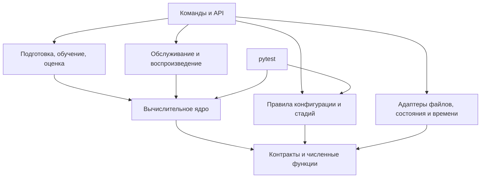

# Архитектура сессионной рекомендательной системы Coveo

Версия: 0.12. Дата: 26 сентября 2026 года. Паспорт и подготовка поддерживают `observed_purchases_v1`. Формат поставки Coveo проверен, полнота телеметрии неизвестна. Э2-01–Э2-08 завершены: A_G из 50 000 сессий перенесён в общие таблицы, исторический пакет проверен независимым пересчётом, повтором и возобновлением. Э1-10 и Э3–Э10 не выполнены. Реализация Э2 — в §11, измерения и ограничения — в [README](/README.md#проверки-и-ограничения).

## 1. Основание и границы

Основание: [ТЗ 1.7](/documents/implementation_spec.md), [математическая спецификация 2.10](/documents/math/coveo_session_recommender_math.tex) и [шаблон паспорта 2.10](/documents/math/coveo_session_recommender_run_manifest.template.json). Хеши исходников — в [ТЗ §19](/documents/implementation_spec.md#19-версия-основания), задачи и приёмка — в [плане разработки](/documents/development_plan.md). Приоритет требований задан во введении ТЗ. Разделы 2–9 описывают целевую архитектуру, §§10–11 — существующий код.

Основной локальный путь — данные → GCS+Rk → отчёт `C_smoke` → выбор на `C_select` → итоговая оценка D. E зарезервирован, калибровка отключена. Сервис Э6 — отдельная ветвь после фиксации алгоритмических контрактов; его готовность и нагрузочная приёмка не открывают и не блокируют локальную оценку Э7. Формулы, параметры и проверки остаются в ТЗ и математической спецификации.

## 2. Основные решения

- Один Python-пакет с отдельными командами и API: вычисления переиспользуются при подготовке, обучении и обслуживании.
- Чистые функции и адаптеры ввода, хранения и времени: алгоритмы проверяются без HTTP и СУБД.
- Типизированные внутренние структуры и схемы внешних данных: ошибки входа обнаруживаются до расчёта.
- Общий расчёт состояния, источников и признаков: обучение и сервис используют одинаковые преобразования.
- Неизменяемые артефакты с зависимостями: смена входов или кода обнаруживается до повторного использования результата.

Границы существующих и запланированных модулей заданы в §3. Для локального пути реализуются только необходимые вычисления, ввод и оценка; сервисные адаптеры, наблюдение и A/B относятся к своим этапам.

## 3. Границы модулей и зависимости

| Модуль | Ответственность |
|---|---|
| `contracts`, `numerics` | Структуры, единицы, статусы, порядок ID и проверяемая арифметика. Не зависят от остальных модулей. |
| `data` | Чтение CSV, канонизация, время, расписание и распределение целых сессий по периодам. Чтение отделено от преобразований. |
| `state` | Чистый `StateReducer`, доступный префикс и интерфейс хранилища с адаптерами памяти и рабочей СУБД. |
| `targets` | Зарегистрированные будущие покупки, кандидатные метки и состав сессий с непустой целью для обучения и оценки. Недоступен обслуживанию запросов. |
| `historical` | Сборка каталога, графов, статистик и векторов. Загрузчик готового пакета не импортирует сборщик. |
| `retrieval` | Источники, точные баллы, квоты, объединение, происхождения и резерв. Не использует метки и ранжировщик. |
| `features` | `FeatureEngine` по закреплённой схеме; общие функции расчёта баллов источников. Обратная зависимость `retrieval → features` запрещена. |
| `ranking` | Раздельные обучение и применение ранжировщика. Применение получает готовые признаки и совместимую модель, не читает обучающие таблицы. Баллы не являются вероятностями покупки. |
| `serving` | Конвейер рекомендации и управление запросом: API, сроки, доступность источников, выбор ветви и обязательная запись. Транспорт отделён от вычислений. |
| `explanations` | Объяснения по расчётной опоре выбранной ветви и шаблонам пакета. Публичная форма отделена от диагностики. |
| `evaluation`, `experiments` | Сессионные метрики и интервалы; отдельно — назначения и анализ A/B. |
| `config`, `artifacts` | Конфигурация и допуск стадий; хранение и совместимость артефактов. |
| `verification` | Идентификация исполняемого кода. Тесты выполняет обычный `pytest`; соответствие ID тестам хранится как данные. |
| `monitoring`, `reporting` | Наблюдение, защитные действия и отчёты по сохранённым измерениям. |
| `cli`, `extensions` | Сборка рабочих сценариев; подключение расширений через объявленные интерфейсы и конфигурацию. |

Стрелка означает зависимость от используемого компонента. Ядро включает чистые части обработки данных, состояния, отбора, признаков, моделей и объяснений.

Адаптеры передаются через интерфейсы. Ядро не импортирует HTTP, СУБД, `cli` и часы процесса. Проверка стадии читает сведения об артефактах и результатах, но не запускает обучение или тесты.

Сценарий в `cli` или API передаёт канонический блок в `StateReducer`, затем префикс — в функции расписания; зависимости `data → state` нет. Применение моделей не импортирует обучение. Доступ сервиса к хранилищам будущих целей закрыт.

Основание: [ТЗ §§2.1–2.3](/documents/implementation_spec.md#2-архитектура-и-общие-требования), [§14](/documents/implementation_spec.md#14-команды-и-поведение-конвейера); `sec:operations-features`, `sec:eval-maturity`.

## 4. Основные контракты

Поля и сигнатуры заданы в [ТЗ §§3.2](/documents/implementation_spec.md#32-логические-структуры) и [2.3](/documents/implementation_spec.md#23-главные-интерфейсы-ядра). Дополнительные решения:

| Контракт | Передача и ограничения |
|---|---|
| `CanonicalBlock` | Канонизация → состояние и подготовка. Целая одновременная группа с кратностями, причинами непригодности поиска и происхождением; завершённость исторической группы не заменяет подтверждение рабочего конверта. |
| `PrefixSnapshot`, `PreparedRequest`, `RequestContext` | Состояние → расписание, отбор и признаки. Подготовленный запрос не требует ещё не построенного каталога. `RequestContext` добавляет его хеш при применении. Текущая запись с более поздними событиями не заменяет срез; будущее число запросов и исход не входят в контекст. |
| `TargetRecord`, `SupervisionRecord` | Подготовка целей и весов → обучение/оценка. Цель содержит все различные SKU зарегистрированных покупок в установленном окне, пустая цель не подтверждает отсутствие покупки. Отдельные наборы присоединяются к признакам по `request_id` только в пакетном сценарии. |
| `HistoricalPackage` | Сборщик → отбор и признаки. Набор из A_G без ранжировщика, достаточный для построения таблицы B. |
| Результат источника, `CandidateResult` | Источники → объединение, признаки и объяснения. Список после квоты, измеримый балл, ранг, доступность и опора хранятся отдельно; неизмеренный список не считается пустым. |
| `FeatureBatch` | Расчёт признаков → ранжировщик. Порядок SKU/столбцов и хеш схемы проверяются вместе с моделью; метки и веса хранятся отдельно. |
| Пакет рекомендации | Хранилище артефактов → запрос. Состав — по §10.4 ТЗ; без калибратора и признака исторической покупочной частоты. |
| `StateTransition` | `StateReducer` → хранилище. Расчёт перехода отделён от атомарного сравнения версии и записи событий, квитанции, состояния и полноты. Конфликт возвращается вызывающему сценарию. |
| `execution_context`, `RequestResult` | Координатор → конвейер и учёт. Остаточный срок и доступность источников задаются явно; выбранная ветвь, кандидаты и доставка фиксируются раздельно. |

Ошибки обязательного входа, пропуски модальностей и внутренняя неконечность имеют разные причины. Ранние структуры определены в `src/coveo_recsys/contracts/`; цели и веса вынесены в `contracts.training` и не импортируются контрактами обслуживания.

## 5. Путь данных при подготовке, обучении и оценке

1. Чтение всех опубликованных строк выбранной сессии → канонические блоки → единственный запрос после первого подходящего detail-блока до зарегистрированной покупки → календарный допуск, периоды и подвыборка. Цели сохраняются отдельно; будущие покупки не влияют на момент запроса или отбор ID.
2. Все сохранённые сессии A_G, с зарегистрированной покупкой и без неё → `HistoricalPackage`. Данные последующих периодов не пополняют пакет; A_N в базе и E зарезервированы. Полнота чтения строк не подтверждает полноты телеметрии.
3. Первые запросы B → общий отбор → `FeatureEngine` → присоединение целей и весов → обучение ранжировщика на сессиях с непустой зарегистрированной целью. Отбор по цели не передаётся в кандидаты и признаки. Сессии без цели остаются для измерения ресурсов и отказов.
4. Обученный ранжировщик → пакет для последующих запросов. Историческая покупочная частота исключена из схемы признаков; счётчики зарегистрированных покупок и популярность A_G сохраняются.
5. `post_training` → `ideal_deterministic` на C_smoke → присоединение зарегистрированных целей → Hit@20 среди сессий с непустой целью → отчёты с числом всех сохранённых и положительных сессий. Цели вне каталога и отказы не исключаются из знаменателя.
6. По закреплённому плану: C_select → фиксация модели → итоговая оценка D. К D обязателен вариант без метаданных с собственными признаками и ранжировщиком. Пороги точности задаются в долях; результат не оценивает вероятность или причинный прирост покупок.

Проверки формата закрытых периодов разрешены отдельно от доступа к исходам и показателям качества. Локальное разделение обеспечивают маршруты чтения; рабочие права доступа и аудит относятся к Э6.

Основание: [ТЗ §§5–9](/documents/implementation_spec.md#5-подготовка-событий-запросов-и-целей), [§14](/documents/implementation_spec.md#14-команды-и-поведение-конвейера); `sec:eval-periods`, `sec:eval-stages`, `sec:metadata-sensitivity`.

## 6. Путь данных при обслуживании

Эта ветвь реализуется в Э6 и принимается перед рабочим обслуживанием и пилотом. Она использует те же алгоритмы, что и локальный путь.

1. Адаптер проверяет отправителя, лимиты, полный `sealed_block_v1` и повторы. Канонизация и `StateReducer` рассчитывают переход; хранилище атомарно подтверждает его. Серверное время принятия становится временем доступности новых событий.
2. Сценарий проверяет расписание и идемпотентность, получает `PrefixSnapshot` и совместимый пакет. При объединённом маршруте a_q фиксируется после атомарного принятия блока; общий срок — от первого байта.
3. Конвейер готовит резерв, выполняет отбор, признаки и ранжирование в оставшееся время. Координатор выбирает ветвь; префикс и пакет закреплены за запросом.
4. Объяснения, обязательная запись и публичный ответ завершают запрос. Кандидаты выбранной ветви, доставка и причины фиксируются в учёте. Ошибка ответа не отменяет принятые события.

При недоставке после выбора ветви её кандидаты сохраняются, доставленный список пуст. До выбора готовой ветви пусты оба множества. Резерв использует собственные происхождения и объяснения, без основного ранжировщика.

Восстановление из контрольной точки использует тот же `StateReducer`. Режим `execution_trace` повторяет записанные версии, доступность, ветвь и доставку; исправный повтор расчёта не восстанавливает отсутствующую трассу.

Основание: [ТЗ §10](/documents/implementation_spec.md#10-сервис-состояние-и-версии), [§9.3](/documents/implementation_spec.md#93-режим-воспроизведения); `sec:ops-transport-block`, `sec:ops-state-storage`, `sec:ops-replay-trace`, `sec:ops-deadlines`.

## 7. Версии и зависимости артефактов

Каталог запуска — по [ТЗ §3.3](/documents/implementation_spec.md#33-каталог-запуска). Первая реализация хранения — локальные файлы: Parquet для таблиц, массивы с явными типами, формой и порядком ID для матриц. Библиотеки и кодеки закрепляются в Э0.

| Идентификатор | Назначение |
|---|---|
| Версия схемы | Правило чтения структуры. |
| SHA-256 артефакта | Хеш точных байтов; описание содержит зависимости от входов, конфигурации и кода. |
| `run_id`, `config_id` | Запуск и зарегистрированный вариант; не заменяют проверку хешей. |
| `package_id` | Идентификатор неизменяемого состава пакета. |
| Версии состояния и префикса | Атомарное обновление и восстановление среза. Ключ кэша также включает t_q и пакет. |
| Паспорт запуска | Один файл с закреплёнными входами, кодом, настройками и планами; результаты расчётов и тестов сохраняются отдельно. |

До вычислений закрепляются входы, код, схемы и настройки; планы оценки фиксируются до доступа к соответствующим оценочным данным. Отдельные результаты ссылаются на запуск, его настройки и проверенные входы. Обязательных снимков паспорта по стадиям, отдельных файлов его контрольных сумм и универсального реестра артефактов нет. Результаты запуска исключаются из области хеширования кода.

Публикация: промежуточная запись → проверка → неизменяемый файл. Повторное использование требует совпадения входных хешей, конфигурации и кода.

| Изменение | Пересборка и повторные проверки |
|---|---|
| Канонизация, расписание, периоды или состав сессий | Затронутые наборы, исторический пакет, признаки, модели и оценки. |
| Исторический пакет, отбор, кодировщик, квоты или схема признаков | Кандидаты и признаки B, ранжировщик, пакет и затронутые проверки. |
| Ранжировщик | Пакет, выдача и оценки. |
| Шаблоны объяснений | Пакет, EXPL01 и затронутые испытания обслуживания; без переобучения ранжировщика. |
| Оформление отчёта | Читаемый отчёт из прежних машинных результатов. |

Время сборки отличается от времени публикации. Запрос выбирает последнюю совместимую публикацию строго до t_q, не до a_q, и закрепляет её до завершения. Смена схемы состояния требует проверенной миграции либо восстановления.

Пакет загружается без исполнения сериализованного кода, с проверкой путей, размеров, типов и совместимости. Для рабочего сервиса обязательны подпись по отдельно доверенному ключу, владельцы, контроль доступа и проверяемое удаление данных, состояния, журналов и копий по установленным срокам. Эти требования принимаются в Э6 и перед пилотом. Хеш удалённого входа не позволяет его воспроизвести.

Основание: [ТЗ §§10.3–10.4](/documents/implementation_spec.md#103-состояние-и-переходы), [§11.2](/documents/implementation_spec.md#112-доступ-и-сроки); `sec:eval-snapshots`, `sec:ops-security`, `sec:freshness-publication`.

## 8. Управление конфигурацией и приёмкой

Проверка паспорта: JSON Schema → смысловые связи → условия стадии и её артефакты. Модули получают проверенную конфигурацию своей части, без общего изменяемого JSON.

`config` проверяет обязательные к текущему шагу поля, результаты и неизменность закреплённых планов. Флаг в паспорте сам по себе не доказывает прохождение проверки или фиксацию плана.

`manifest init` создаёт `manifest.json` в каталоге запуска. `manifest validate` принимает внешние закреплённые хеши планов через `--plan-reference NAME=SHA256`: `before_C_select`, `before_D`, `before_AB` к их срокам. `--operation evaluate` проверяет допуск к оценке, включая B12, но не выполняет расчёт; будущие команды до реализации возвращают отказ.

Проверки выполняются через `pytest`; ID требований связываются с тестами и их результатами. Эталоны независимы от проверяемых функций. Хеш и снимок каждого теста и его предварительная регистрация отдельным артефактом не обязательны. Части B03, B05, B10 и X02 учитываются отдельно; статус целого ID определяется всеми применимыми частями к их сроку. Статусы тестов, системы и метрик хранятся раздельно. B09 проверяет отсутствие покупочной частоты, B11 — отключённую калибровку и неиспользование E.

Приёмка кода на искусственных данных и реальный `preflight` разделены в [Э1-10 плана](/documents/development_plan.md#э1-10-допуск-первого-реального-запуска). Порядок открытия периодов и проверки до C_smoke — в [§5 плана](/documents/development_plan.md#5-контрольные-точки-запуска). План точности нужен до обучения, окончательная сетка и блоки — до D (`sec:eval-precision`, `sec:eval-time-block`).

Основание: [ТЗ §4](/documents/implementation_spec.md#4-паспорт-запуска-и-управление-этапами), [§15](/documents/implementation_spec.md#15-тестирование-и-прослеживаемость), [§17.2](/documents/implementation_spec.md#172-раздельные-решения); `app:run-manifest`, `app:run-stages`, `app:tests-normative`, `sec:acceptance`.

## 9. Решения по мере реализации

| Решение | Срок и результат |
|---|---|
| Среда | Э0: CPython 3.11.9, зависимости и хеши в `uv.lock`, состав — в `pyproject.toml`. Нейросетевой профиль устанавливается отдельно. |
| Фактические входы | Формат и локальные хеши проверены; подготовка использует `observed_purchases_v1`. До Э2 принимается малый реальный A_G; результаты — в README. `preflight` до обучения дополнительно требует кода Э3–Э4; неизвестная полнота телеметрии не препятствует оценке зарегистрированных целей. |
| Признаки | Э3, до реального `preflight` и обучения: раскладка столбцов, преобразования и хеш схемы. |
| План оценки | По срокам §18 ТЗ: даты, объёмы, сетка и допущения по разрешённым ранним данным, без использования результатов D. |
| Рабочее хранилище состояния | Э6: выбор СУБД, адаптеры, проверка конкурентных обновлений, отказов и восстановления. |
| Нагрузка и публикация | До испытаний: процессы, потоки и измеритель памяти; до рабочего профиля — доверенные ключи, владельцы и сроки. |
| Расширения | Э8–Э9 после диагностики базы: зарегистрированный вопрос, собственные артефакты и проверки. |
| Рабочий A/B | Э10: протокол, раздельный учёт назначений/показов/исходов, эксплуатационный допуск и ответственные. |

Основание сроков — [ТЗ §18](/documents/implementation_spec.md#18-что-требуется-уточнить-до-соответствующих-этапов). Решения и их причины фиксируются здесь; ход работ и результаты — в плане разработки.

## 10. Текущая реализация

### 10.1. Контракты и хранение

- Неизменяемые `dataclass` с вложенными кортежами: контракты подготовки имеют версию 3, события и остальные неизменённые записи — версию 2. JSON-кодек сохраняет int64, исходные UTF-8 ID и `null`; неизвестные поля и версии отклоняются. Схемы строятся из типов, смысловые ограничения проверяются конструкторами. Физическая раскладка файлов не меняет версии записей.
- Локальная публикация использует временный файл на том же томе и проверку без перезаписи готового результата. Итоговый файл отмечает готовность набора после проверок: для подготовки — §10.3, исторического пакета — §11.2.
- Матрицы хранятся в NPY без объектов и `pickle`. Формат общих Parquet-таблиц подготовки — `preparation_tables_v1`: ключ `session_id: string` и `record_json: binary` со строгим конвертом записи. Сессии упорядочены по UTF-8 ID; порционное чтение возвращает целую сессию, даже если она пересекает границу порции. Столбцовая раскладка признаков — решение Э3.
- Хеш кода строится по явному перечню исходников, тестов, схем, конфигураций, зависимостей и правил упаковки `.gitignore`. Хеши нормативных документов сохраняются отдельно; редакторские правки документации не меняют хеш кода. `/data/` исключает только исходные данные в корне; модули `src/coveo_recsys/data/` входят в Git и wheel. Состав пакета проверяется чистой установкой вне каталога исходников.

`coveo-recsys environment` фиксирует версии, сборку Python, компилятор и BLAS разработческой среды; нагрузочный узел измеряется отдельно. Сборщик закреплён вместе с библиотеками, базовая установка не включает PyTorch.

### 10.2. Подготовка данных

Подготовка реализует один первый запрос, календарный допуск и зарегистрированные цели по [ТЗ §5.3](/documents/implementation_spec.md#53-зарегистрированные-цели-и-календарный-допуск). Пустые цели имеют неизвестный статус; полнота телеметрии не утверждается. Покупочная когорта удалена.

- `RawEvent.transport_id` — подтверждённый ID доставки; технический `event_id` без него не доказывает повтор. Ключ сессии включает пространство источника. Ссылки на строки сохраняют хеш точного CSV: перестановка строк меняет происхождение, но не семантический результат.
- Двухпроходная внешняя сортировка проверяет повторы доставки и формирует целые одновременные блоки без предположения об исходном порядке CSV. Ограничения порции и группы явные; превышение даёт отказ, не усечение.
- Поздний блок требует повторного расчёта `reduce_state` из полного журнала. Ограничения хвостов не удаляют начало истории, полные счётчики и последнюю detail-группу.
- [Искусственный профиль](/configs/synthetic_csv.json) и [его план](/configs/synthetic_preparation.json) сохраняются для тестов. Фактическое чтение использует [профиль Coveo](/configs/coveo_supply_v1.json), правила `data/supply.py` и общую канонизацию. `PreparationPlan` отделён от паспорта запуска: периоды, размеры выборок, seed и бюджеты закрепляются до просмотра исходов.
- Объём A_G закреплён в [реальном плане](/configs/coveo_preparation.json). Полный проход обоих CSV сводит первые detail/покупку, последнее событие и число строк в краткую временную SQLite-таблицу. Среди допущенных сессий выбираются минимальные нормативные хеши. В памяти остаются ограниченный кеш, порция и выбранные ID; временная БД не становится новым хранилищем проекта.
- Для выбранных ID повторно читаются все строки поведения и поиска. В каталоге запуска сохраняются общие `canonical/<period>.parquet`, `preparation/sessions.parquet`, `datasets/<period>/prefixes.parquet` и отдельная `datasets/<period>/targets.parquet`. Происхождение и число исходных строк сверяются с отбором; поздний хвост не отрезается. Реальная подготовка других периодов, кроме A_G, пока запрещена.
- `data inspect-supply` и `data inspect` проверяют поставку. `data prepare` сверяет хеши, размеры и заголовки с проверенным профилем без повторного аудита векторов всей поставки; выбранные события проходят обычную проверку чтения и канонизации. Исходные CSV не копируются в `.objects/`.
- Статический `validate_sealed_block` проверяет точные байты массива событий, поля и время. Его успех не является квитанцией приёма; аутентификация, повторы, атомарная запись и рабочие ограничения сессии относятся к Э6.

### 10.3. Повтор, проверки и доступ

Один `reports/preparation.json` содержит версию формата, код и входы, точные тексты `profile_json` и `plan_json`, отбор `sampled`, сводку, измерения и SHA-256, размеры и число строк итоговых таблиц. Он публикуется со статусом `completed` после проверки входов, таблиц и ресурсных ограничений. Посессионных файлов, дескрипторов, объектных копий и журнала каждого шага у подготовки нет.

До завершения `preparation/identity.json` закрепляет код, входы и настройки; после публикации сводки он удаляется. Прерывание может оставить этот файл и готовые общие таблицы, но не готовый набор. Повтор незавершённого прохода пересчитывает данные и сверяет уже записанные таблицы, не заменяя отличающийся результат. Для завершённого набора проверяются код, входы, настройки и контрольные суммы таблиц. Продолжения с последней строки CSV нет; временный диск включает SQLite, сортировку и промежуточные файлы публикации. Полный объём Coveo требует отдельного измерения ресурсов.

`DatasetAccess` выдаёт поток целых сессий и проверяет цель чтения, период, тип, схему, область `synthetic/actual`, происхождение и допуск набора. До и после чтения сверяется контрольная сумма выбранной таблицы. Разрешены только допущенные A_G/B/C_smoke; диагностические данные, закрытые периоды и цели вместо префиксов отклоняются. Попытку чтения можно передать вызывающему коду через функцию обратного вызова, без отдельного файла. Владелец локальных файлов имеет прямой доступ; рабочие права относятся к Э6.

## 11. Проект исторического пакета Э2

Реализованы `historical build`, вычислительные ветви, публикация и независимая загрузка пакета. Ниже описан существующий код; выполнение на Coveo и итоговая приёмка учитываются отдельно в [плане Э2](/documents/development_plan.md#41-э2-исторический-пакет). `preflight` эта команда не выполняет.

### 11.1. Входы, модули и контракты

Сборка использует все опубликованные события выбранных сессий A_G, прошедших календарный допуск, а не ограниченные истории запросов или только покупающие сессии. Дополнительно проверяется `t_last_obs + g < b_A_G`; это ограничение хвоста, не доказательство закрытия сессии. Каталог определяется событиями по `eq:request-catalog`, не наличием метаданных или просмотром. Подготовка и адаптер `data/historical.py` используют общий допуск; вычислительные модули `historical` получают проверенный вход.

Контракты размещены в [contracts/historical.py](/src/coveo_recsys/contracts/historical.py) и не импортируют сборщик:

| Контракт | Содержание и граница |
|---|---|
| `HistoricalInput` | `iter_sessions()` повторно выдаёт полные кортежи `CanonicalBlock`; вместе передаются число сессий, граница снимка, пространство ID, область и закреплённые хеши подготовки. Полноту строк проверяет адаптер; полнота телеметрии остаётся неизвестной. |
| `HistoricalConfig` | Время снимка, параметры вычислений, порядок UTF-8, версия пакета и ресурсные пределы. Настройки закреплены в [coveo_historical.json](/configs/coveo_historical.json); искусственный вход не выдаётся за реальный допуск. |
| `MetadataSource` | Закреплённая поставка метаданных, размеры и происхождение пространств. Схема чтения и свидетельство совместимости query/text передаются явно. |
| `HistoricalPackage` | Каталог, графы, статистики и модальности, граница снимка, хеши входов и пути частей. `metadata_contract` сохраняет размеры пространств, основание совместимости query/text и неизвестную историческую доступность метаданных. Без модели, целей B и исходов последующих периодов. |

`DatasetAccess` обслуживает префиксы и цели; его права не расширены. [data/historical.py](/src/coveo_recsys/data/historical.py) порционно читает общие таблицы A_G и реестра, сверяет выбранные ID и все опубликованные строки сессий, повторяет общий календарный допуск только для A_G. Чтения и отказы передаются вызывающему сценарию. Единственный разрешённый импорт из `contracts.training` — `SessionRecord` для реестра допуска; адаптер не импортирует `targets` и не читает таблицы целей. Проверка схемы всей поставки остаётся отдельным маршрутом.

Настройки закрепляют путь готовой подготовки и SHA-256 `reports/preparation.json` со статусом `completed`; дескрипторы и отдельное подтверждение выполнения не нужны. При каждом проходе проверяются сводка и контрольные суммы используемых таблиц. Хеш производителя подготовки сохраняется как `preparation_code` и не обязан совпадать с `source_sha256()` сборщика Э2. Подготовка остаётся неизменной и не копируется в новый запуск.

| Модуль | Ответственность и разрешённые зависимости |
|---|---|
| `historical/catalog.py` | Каталог и общий порядок строк; `contracts`, без чтения CSV. |
| `historical/graph.py` | Вклады сессий и итоговые разрежённые отношения; `contracts`, `numerics`. |
| `historical/statistics.py` | Счётчики просмотров, зарегистрированных покупок и популярность по всем принятым сессиям A_G; без покупочной частоты. Зависит от `contracts`, `numerics`. |
| `historical/content.py` | Модальности, маски, причины непригодности и словари; `contracts`, общая нормировка `numerics`. |
| `historical/build.py` | `build_historical(admitted_A_G, metadata, config, *, work_dir, check_budget=None)`; соединяет вычисления, не решает вопрос допуска команды. |
| `historical/load.py` | Проверка и чтение готового `HistoricalPackage`; `contracts`, `artifacts`. Не импортирует сборщик, `targets` или `cli`. |
| `data/metadata.py` | Порционное чтение выбранных SKU из закреплённого CSV по профилю поставки; повторная проверка хеша и размера. |
| `cli/historical.py` | `run_historical` проверяет входы и бюджеты; `publish_package` публикует согласованные части через `LocalArtifactStore`. Здесь же повтор и отчёты; вычислительные правила остаются в модулях выше. |

Поток сборки: `проверенный вход A_G → каталог → граф / статистики / модальности → проверка согласованности → состав пакета`. После фиксации контрактов и каталога три средние ветви независимы. Загрузчик передаёт пакет будущим `retrieval` и `features`; обратных зависимостей нет.

Метаданные SKU вне I_G могут понадобиться для уже наблюдаемого неизвестного товара в префиксе (`sec:model-content`). `MetadataSource.read` поддерживает отдельное чтение из той же закреплённой поставки без расширения каталога, исторических счётчиков или словаря категорий A_G. Предоставленные векторы сохраняют оговорку о статических метаданных (`ass:static-content`).

### 11.2. Артефакты и версии

Формат пакета — `historical_package_v1`, независимый от версий записей подготовки и паспорта. Состав и проверки чтения заданы в [historical/load.py](/src/coveo_recsys/historical/load.py). Протокол подготовки входит в зависимости входа; одна версия записей не подтверждает совместимость. Неизвестная версия и лишние либо отсутствующие части отклоняются.

Все пути таблицы ниже — внутри `/runs/<run_id>/historical/`:

| Артефакт | Представление и зависимости |
|---|---|
| `settings.json` | Точные байты настроек сборки: закреплённая подготовка, путь метаданных и конфигурация. |
| `catalog.parquet` | `sku: string`, `row_index: int64`; уникальные исходные SKU в порядке UTF-8. Состав определяется только принятым A_G. |
| `graph/<relation>/` | Для `detail_detail`, `detail_add`, `detail_purchase`: `indptr.npy`, `indices.npy`, `weights.npy`, `probabilities.npy`, `support.npy`, `row_sums.npy`, `rho.npy`. Разрежённые строки, FP64/int64, без объектов и `pickle`. `graph/summary.json` хранит объёмы агрегации. |
| `statistics.parquet`, `statistics_summary.json` | SKU, сессионные `detail_count`, `purchase_count`, сглаженная `popularity`; отдельно число всех принятых сессий. Признака покупочной частоты нет. |
| `content/<modality>/`, `dictionaries.json` | Для `description` и `image`: `vectors.npy`, `mask.npy`, `reasons.json`. Отдельно словарь категорий, коды, порядковые ценовые группы и их маски. |
| `package.candidate.json`, `package.json` | Версия, конфигурация, хеши входов и дескрипторов частей, размер каталога, `metadata_contract`. Формы и типы массивов закреплены в дескрипторах. `package.json` — последний маркер готовности пакета. |
| `build_report.json`, `executions/<id>.json` | Отчёт успешной сборки и отдельные записи попыток с чтениями, длительностью, памятью, диском и покрытием. Измерения не меняют математические таблицы. |

Все содержательные части связаны с дескриптором общего каталога. Внешние входы закреплены хешами, локальные зависимости нового хранилища — дескрипторами частей. Загрузчик сверяет состав, происхождение, код, настройки, формы, типы, порядок SKU и математическую согласованность массивов.

После публикации частей записывается `package.candidate.json` и полностью проверяется обычным загрузчиком. Перед `package.json` повторно проверяются неизменность кода и настроек и ресурсные бюджеты. Незавершённая публикация не считается готовым пакетом. При повторе вычисления выполняются заново, но совместимые проверенные части не переписываются; продолжения внутренней сортировки нет. Если `package.json` уже существует, команда заново проверяет вход и все сессии, затем загружает совместимый пакет без вычисления ветвей. Версии и хеши — по [§7](/documents/architecture.md#7-версии-и-зависимости-артефактов).

### 11.3. Стоимость и отложенные решения

Граф строится без матрицы I_G×I_G. Пары записываются ограниченными отсортированными порциями и сливаются на диске с ограниченным числом открытых файлов. После слияния берётся минимальная допустимая задержка на пару и сессию. Отдельно учитываются число промежуточных пар, наибольшая одновременная группа, буфер, чтения/записи и временный диск. Пределы из [coveo_historical.json](/configs/coveo_historical.json) проверяются графовой ветвью и переданным `check_budget`; превышение вызывает отказ без усечения групп. Временные файлы удаляются при успехе и отказе.

Используются FP64 и устойчивые примитивы Э0. Машинное обнуление положительного затухания вызывает численный отказ до фильтра поддержки; оно не превращается в отсутствие пары. Начальное τ_G сохранено.

Проверка поставки подтвердила размерность 50 для поиска, описаний и изображений и их формат; совместимость поиска с описанием следует из заявления издателя, а не равенства размерностей. Историческая доступность метаданных не подтверждена. Измерения подготовки и Э2 — в [README](/README.md#проверки-и-ограничения). Пакет расширенного A_G закреплён по Э2-08; малое покрытие покупочных связей остаётся ограничением. `preflight` требуется до признаков B и обучения по [плану](/documents/development_plan.md#э1-10-допуск-первого-реального-запуска).

Параллельное построение по процессам, дополнительные форматы хранения и индексы поиска можно отложить: они не нужны для проверки формул и модульных границ. Точные кандидаты и признаки — Э3; обучение — Э4; подписи, рабочие права доступа и конкурентная публикация — Э6.
