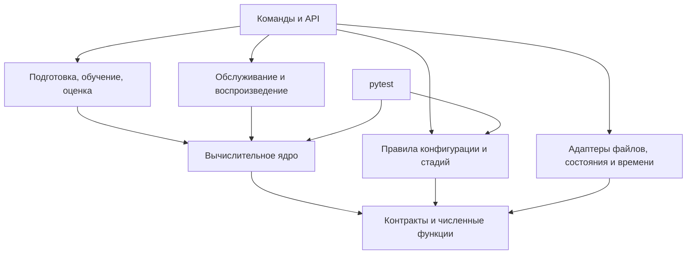

# Архитектура сессионной рекомендательной системы Coveo

[English](/documents/en/architecture.md) | Русский

Версия: 0.28. Дата: 11 октября 2026 года. Реализован путь от подготовки Coveo до локального API и оценки D по `observed_purchases_v1`. `post_D` оформлен с `S_offline=insufficient`; полнота телеметрии неизвестна. После сравнения с обученным вариантом 370 на C_select сохранена основная GCS+Rk на 300 кандидатах. Демонстрационный объём Э6-01–Э6-05 принят; промышленный Э6 и Э8–Э10 отложены. Локальный сервис описан в §6, пакетный путь — в §§11–14; результаты и ограничения — в [README](/README.ru.md).

## 1. Основание и границы

Основание: [ТЗ 1.7](/documents/implementation_spec.md), [математическая спецификация 2.10](/documents/math/coveo_session_recommender_math.tex) и [шаблон паспорта 2.10](/documents/math/coveo_session_recommender_run_manifest.template.json). Хеши исходников — в [ТЗ §19](/documents/implementation_spec.md#19-версия-основания), задачи и приёмка — в [плане разработки](/documents/development_plan.md). Приоритет требований задан во введении ТЗ. Границы и решения — §§2–9; существующий пакетный путь — §§10–14, локальный сервис — §6.

Основной локальный путь — данные → GCS+Rk → отчёт `C_smoke` → фиксация политики и плана → итоговая оценка D. Подбор на `C_select` необязателен для первой фиксированной модели. E зарезервирован, калибровка отключена. Сервис Э6 — отдельная ветвь; его готовность и нагрузочная приёмка не открывают и не блокируют локальную оценку Э7. Формулы, параметры и проверки остаются в ТЗ и математической спецификации.

Для нового малого запуска [verification/reproduce.py](/src/coveo_recsys/verification/reproduce.py) создаёт настройки отдельных команд, запускает прямую сверку опубликованных строк и собирает допуски по текущим проверкам и JUnit. Скрипт не заменяет вычислительные команды и не использует прежние `runs/`. Штатные проверки и ограничения периодов сохранены. Малый запуск проверен на Coveo из отдельной обычной установки; команды, результаты и ограничения — в [инструкции](/documents/reproduction.md#порядок-полного-расчёта).

## 2. Основные решения

- Один Python-пакет с отдельными командами и API: подготовка, обучение и обслуживание используют общие вычислительные функции.
- Чистые функции и адаптеры ввода, хранения и времени: алгоритмы проверяются без HTTP и СУБД.
- Типизированные внутренние структуры и схемы внешних данных: ошибки во входных данных обнаруживаются до расчёта.
- Общий расчёт состояния, источников и признаков: обучение и сервис используют одинаковые преобразования.
- Неизменяемые артефакты с зависимостями: изменения входных данных или кода обнаруживаются до повторного использования результата.

Границы существующих и запланированных модулей заданы в §3. Для локального запуска реализуются только необходимые вычисления, ввод и оценка; адаптеры сервиса, наблюдение и A/B предусмотрены на соответствующих этапах.

## 3. Границы модулей и зависимости

| Модуль | Ответственность |
|---|---|
| `contracts`, `numerics` | Структуры, единицы, статусы, порядок ID и проверяемая арифметика. Не зависят от остальных модулей. |
| `data` | Чтение CSV, канонизация, время, расписание и распределение целых сессий по периодам. Чтение отделено от преобразований. |
| `state` | Чистый `StateReducer`, доступный префикс, приём и адаптеры памяти/файла. Рабочий адаптер PostgreSQL ещё не реализован. |
| `targets` | Зарегистрированные будущие покупки, метки кандидатов и состав сессий с непустой целью для обучения и оценки. Недоступен при обслуживании запросов. |
| `historical` | Сборка каталога, графов, статистик и векторов. Загрузчик готового пакета не импортирует сборщик. |
| `retrieval` | Источники, точные баллы, квоты, объединение, сведения о происхождении и резерв. Не использует метки и ранжировщик. |
| `features` | `FeatureEngine` по закреплённой схеме; использует общие баллы из `retrieval`. Обратная зависимость `retrieval → features` запрещена. |
| `ranking` | Обучение и применение ранжировщика разделены. При применении используются готовые признаки и совместимая модель; обучающие таблицы не читаются. Баллы не являются вероятностями покупки. |
| `serving` | Конвейер рекомендации и управление запросом: API, сроки, доступность источников, выбор ветви и обязательная запись. Транспорт отделён от вычислений. |
| `explanations` | Объяснения по расчётной опоре выбранной ветви и шаблонам пакета. Публичная форма отделена от диагностики. |
| `evaluation`, `experiments` | Сессионные метрики и интервалы; отдельно — назначения и анализ A/B. |
| `config`, `artifacts` | Конфигурация и допуск к стадиям; хранение и совместимость артефактов. |
| `verification` | Идентификация исполняемого кода. Тесты выполняет обычный `pytest`; соответствие ID тестам хранится как данные. |
| `monitoring`, `reporting` | Наблюдение, защитные действия и отчёты по сохранённым измерениям. |
| `cli`, `extensions` | Сборка рабочих сценариев; подключение расширений через объявленные интерфейсы и конфигурацию. |

Стрелка указывает на используемый компонент. Ядро включает чистые компоненты обработки данных и состояния, отбора, расчёта признаков, работы с моделями и объяснениями.

Адаптеры передаются через интерфейсы. Ядро не импортирует HTTP, СУБД, `cli` и часы процесса. Проверка стадии читает сведения об артефактах и результатах, но не запускает обучение или тесты.

Сценарий в `cli` или API передаёт канонический блок в `StateReducer`, затем префикс — в функции расписания; зависимости `data → state` нет. Применение моделей не импортирует обучение. Доступ сервиса к хранилищам будущих целей закрыт.

Основание: [ТЗ §§2.1–2.3](/documents/implementation_spec.md#2-архитектура-и-общие-требования), [§14](/documents/implementation_spec.md#14-команды-и-поведение-конвейера); `sec:operations-features`, `sec:eval-maturity`.

## 4. Основные контракты

Поля и сигнатуры заданы в [ТЗ §§3.2](/documents/implementation_spec.md#32-логические-структуры) и [2.3](/documents/implementation_spec.md#23-главные-интерфейсы-ядра). Дополнительные решения:

| Контракт | Передача и ограничения |
|---|---|
| `CanonicalBlock` | Канонизация → состояние и подготовка. Целая одновременная группа с кратностями, причинами непригодности поиска и происхождением; завершённость исторической группы не заменяет подтверждение рабочего конверта. |
| `PrefixSnapshot`, `PreparedRequest`, `RequestContext` | Состояние → расписание, отбор и признаки. Подготовленный запрос не требует ещё не построенного каталога. `RequestContext` добавляет его хеш при применении. Текущая запись с более поздними событиями не заменяет срез; будущее число запросов и исход не входят в контекст. |
| `TargetRecord`, `SupervisionRecord` | Подготовка целей и весов → обучение/оценка. Цель содержит все различные SKU зарегистрированных покупок в установленном окне, пустая цель не подтверждает отсутствие покупки. Отдельные наборы присоединяются к признакам по `request_id` только в пакетном сценарии. |
| `HistoricalPackage` | Сборщик → отбор и признаки. Набор из A_G без ранжировщика, достаточный для построения таблицы B. |
| Результат источника, `CandidateResult` | Источники → объединение, признаки и объяснения. Список после квоты, измеримый балл, ранг, доступность и опора хранятся отдельно; неизмеренный список не считается пустым. |
| `FeatureBatch` | Расчёт признаков → ранжировщик. Порядок SKU/столбцов и хеш схемы проверяются вместе с моделью; метки и веса хранятся отдельно. |
| `TrainingTable`, `RankerModel` | Таблица хранит матрицу, метки и размеры упорядоченных групп; модель — загруженный LightGBM и сводку совместимости. Применение использует только модель, `FeatureBatch` и хеш каталога. |
| Пакет рекомендации | Хранилище артефактов → запрос. Состав — по §10.4 ТЗ; без калибратора и признака исторической покупочной частоты. |
| `StateTransition` | `StateReducer` → сценарий: чистый результат изменения префикса, не подтверждение приёма и не операция хранилища. Контракт редуктора сохранён. |
| `StoredSession`, `BlockReceipt`, `Acceptance` | Приём → `StateStore`: журнал, снимок, полнота и квитанции по `(source_namespace, session_id)`. CAS-ревизия `StoredSession` не подменяет версию префикса; результат атомарной записи возвращается сценарию. |
| `execution_context`, `RequestResult` | Координатор → конвейер и учёт. Остаточный срок и доступность источников задаются явно; выбранная ветвь, кандидаты и доставка фиксируются раздельно. |

Ошибки в обязательных входных данных, пропуски модальностей и неконечные значения внутри вычислений имеют разные причины. Структуры ранних этапов определены в `src/coveo_recsys/contracts/`; цели и веса вынесены в `contracts.training` и не импортируются контрактами обслуживания.

## 5. Путь данных при подготовке, обучении и оценке

1. Чтение всех опубликованных строк выбранной сессии → канонические блоки → единственный запрос после первого подходящего detail-блока до зарегистрированной покупки → календарный допуск, периоды и подвыборка. Цели сохраняются отдельно; будущие покупки не влияют на момент запроса или отбор ID.
2. Все сохранённые сессии A_G, с зарегистрированной покупкой и без неё → `HistoricalPackage`. Данные последующих периодов не пополняют пакет; A_N в базе и E зарезервированы. Полнота чтения строк не подтверждает полноты телеметрии.
3. Первые запросы B → общий отбор → `FeatureEngine` → присоединение целей и весов → обучение ранжировщика на сессиях с непустой зарегистрированной целью. Отбор по цели не передаётся в кандидаты и признаки. Сессии без цели остаются для измерения ресурсов и отказов.
4. Обученный ранжировщик → пакет для последующих запросов. Историческая покупочная частота исключена из схемы признаков; счётчики зарегистрированных покупок и популярность A_G сохраняются.
5. `post_training` → `ideal_deterministic` на C_smoke → присоединение зарегистрированных целей → Hit@20 среди сессий с непустой целью → отчёты с числом всех сохранённых и положительных сессий. Цели вне каталога и отказы не исключаются из знаменателя.
6. Фиксация модели и плана → итоговая оценка D; C_select нужен только при подборе. К D обязателен вариант без метаданных с собственными признаками и ранжировщиком. Пороги точности задаются в долях; результат не оценивает вероятность или причинный прирост покупок.

Проверки формата закрытых периодов разрешены отдельно от доступа к исходам и показателям качества. Локальное разделение обеспечивают маршруты чтения; рабочие права доступа и аудит относятся к Э6.

Основание: [ТЗ §§5–9](/documents/implementation_spec.md#5-подготовка-событий-запросов-и-целей), [§14](/documents/implementation_spec.md#14-команды-и-поведение-конвейера); `sec:eval-periods`, `sec:eval-stages`, `sec:metadata-sensitivity`.

## 6. Путь данных при обслуживании

Э6-01–Э6-05 приняты как локальная демонстрация по обновлённому ТЗ; четыре сценария прошли на готовых пакете и модели. Результат и ограничения — в [README](/README.ru.md#пример-рекомендаций). [serve](/src/coveo_recsys/cli/serving.py) запускает один процесс API на локальном интерфейсе с профилем `local_checksum_only` и общими алгоритмами Э3–Э4. `load` остаётся заглушкой; рабочее обслуживание, нагрузочные испытания и пилот не приняты.

Согласованный объём демонстрации: один общий тайм-аут 1000 мс по [ТЗ §10.5](/documents/implementation_spec.md#105-срок-ответа-и-выбор-ветви), без нормативных сроков этапов и настройки ядер. Настройки `timeout_ms` и `reserve_ms` передаются из конфигурации в HTTP-протокол и координатор. Приём, состояние и вычисления используют один абсолютный срок с запасом 100 мс; запись и возврат — общий срок. Трасса хранит фактический тайм-аут. Промышленная эксплуатация Э6-06–Э6-11 не обязательна для портфолио. Проверки повторов, допустимости и позднего завершения сохранены.

Контракты локального сервиса:

- [IntakeService](/src/coveo_recsys/state/service.py) связывает отправителя с `source_namespace`; ключ состояния — `(source_namespace, session_id)`. CAS-ревизия `StoredSession` отделена от версии восстановленного префикса. События, квитанции и отметки публикуются вместе; транспортный и канонический ID блока различаются.
- Карантин хранит не более 1 МиБ UTF-8 текста отклонённых конвертов на сессию. При переполнении новые конверты не сохраняются, но причины разрыва и неполнота остаются; принятые события не удаляются.
- Первый запрос закрепляется отдельным журналом по сессии, ключу идемпотентности, запускающему блоку и двум временам. Повтор не вычисляет ответ заново. Незавершённый запрос после перезапуска не исполняется повторно.
- [Загрузчик пакета](/src/coveo_recsys/serving/package.py) связывает готовые исторический пакет, модель, схему, параметры отбора и шаблоны, сохраняя хеши производителя. Размеры ограничиваются до загрузки; при порционном хешировании проверяется бюджет. Все метаданные поставки загружаются один раз; SKU вне A_G не расширяют каталог кандидатов.
- [TimedH11Protocol](/src/coveo_recsys/serving/protocol.py) фиксирует `perf_counter` первого байта до ASGI, сохраняя время фрагментированных и конвейерных запросов. Координатор использует исходный срок и ограниченный [пул чистых вычислений](/src/coveo_recsys/serving/runtime.py); поздний расчёт не публикует результат. Проверка срока перед атомарной записью не делает системный вызов прерываемым. Журнал хранит выбор ветви и окончательный исход; отсутствие проверенного среза не подменяется пустой историей.
- Тестовые адаптеры — память и один ограниченный JSON-снимок для файлового воспроизведения. Они не предназначены для нескольких процессов. Для Э6-06 выбрана PostgreSQL: транзакция и [блокировка строки](https://www.postgresql.org/docs/current/explicit-locking.html#LOCKING-ROWS) позволяют связать версию состояния, события и квитанцию без отдельного кэша. Адаптер, развёртывание и восстановление СУБД отложены.

1. Адаптер проверяет отправителя, лимиты, полный `sealed_block_v1` и повторы. Канонизация и `StateReducer` рассчитывают переход; хранилище атомарно подтверждает его. Серверное время принятия становится временем доступности новых событий.
2. Сценарий проверяет расписание и идемпотентность, получает `PrefixSnapshot` и совместимый пакет. При объединённом маршруте a_q фиксируется после атомарного принятия блока; общий срок — от первого байта.
3. Конвейер готовит резерв, выполняет отбор, признаки и ранжирование в оставшееся время. Координатор передаёт проверку срока в `FeatureEngine`: расчёт останавливается между кандидатами и до вызова модели, без частичного пакета признаков. Входы операций закреплены; переключение на резерв их не меняет. Слот пула удерживается до фактического завершения. Координатор выбирает ветвь; префикс и пакет закреплены за запросом.
4. Объяснения, обязательная запись и публичный ответ завершают запрос. Журнал получает те же проверенные неизменяемые записи, проверяет их связи и сериализует один раз; чтение журнала сохраняет строгую проверку байтов. Кандидаты выбранной ветви, доставка и причины фиксируются в учёте. Ошибка ответа не отменяет принятые события.

Если ответ не доставлен после выбора ветви, её кандидаты сохраняются, а доставленный список пуст. До выбора готовой ветви пусты оба множества. Резерв использует собственные сведения о происхождении и объяснения, без основного ранжировщика.

Файловое воспроизведение использует тот же `StateReducer`. [execution_trace](/src/coveo_recsys/serving/trace.py) проверяет записанные версии, доступность, ветвь и доставку; повтор не заменяет условия исполнения на `ideal_deterministic` и не восстанавливает отсутствующую трассу. Э6-06–Э6-11 ещё не начаты; подпись, рабочие права, восстановление СУБД и нагрузочная приёмка остаются отдельными задачами.

Основание: [ТЗ §10](/documents/implementation_spec.md#10-сервис-состояние-и-версии), [§9.3](/documents/implementation_spec.md#93-режим-воспроизведения); `sec:ops-transport-block`, `sec:ops-state-storage`, `sec:ops-replay-trace`, `sec:ops-deadlines`.

## 7. Версии и зависимости артефактов

Каталог запуска — по [ТЗ §3.3](/documents/implementation_spec.md#33-каталог-запуска). В первой реализации данные хранятся в локальных файлах: таблицы — в Parquet, матрицы — в массивах с явными типами, формой и порядком ID. Библиотеки и кодеки закрепляются в Э0.

| Идентификатор | Назначение |
|---|---|
| Версия схемы | Правило чтения структуры. |
| SHA-256 артефакта | Хеш точных байтов; описание содержит зависимости от входов, конфигурации и кода. |
| `run_id`, `config_id` | Запуск и зарегистрированный вариант; не заменяют проверку хешей. |
| `package_id` | Идентификатор неизменяемого состава пакета. |
| Версии состояния и префикса | Атомарное обновление и восстановление среза. Ключ кэша также включает t_q и пакет. |
| Паспорт запуска | Один файл с закреплёнными входами, кодом, настройками и планами; результаты расчётов и тестов сохраняются отдельно. |

До вычислений закрепляются входы, код, схемы и настройки; планы оценки фиксируются до доступа к соответствующим оценочным данным. Отдельные результаты ссылаются на запуск, его настройки и проверенные входы. Обязательных снимков паспорта по стадиям, отдельных файлов его контрольных сумм и универсального реестра артефактов нет. Результаты запуска исключаются из области хеширования кода.

Публикация: промежуточная запись → проверка → неизменяемый файл. Повторное использование требует совпадения входных хешей, конфигурации и кода.

| Изменение | Пересборка и повторные проверки |
|---|---|
| Канонизация, расписание, периоды или состав сессий | Затронутые наборы, исторический пакет, признаки, модели и оценки. |
| Исторический пакет, отбор, кодировщик, квоты или схема признаков | Кандидаты и признаки B, ранжировщик, пакет и затронутые проверки. |
| Ранжировщик | Пакет, выдача и оценки. |
| Шаблоны объяснений | Пакет, EXPL01 и затронутые испытания обслуживания; без переобучения ранжировщика. |
| Оформление отчёта | Читаемый отчёт из прежних машинных результатов. |

Время сборки отличается от времени публикации. Запрос выбирает последнюю совместимую публикацию строго до t_q, не до a_q, и закрепляет её до завершения. Смена схемы состояния требует проверенной миграции либо восстановления.

Пакет загружается без исполнения сериализованного кода, с проверкой путей, размеров, типов и совместимости. Для рабочего сервиса обязательны подпись ключом, доверие к которому задано отдельно, владельцы, контроль доступа и проверяемое удаление данных, состояния, журналов и копий в установленные сроки. Эти требования относятся к отложенному рабочему профилю, не к локальной демонстрации. Хеш удалённого входа не позволяет его воспроизвести.

Основание: [ТЗ §§10.3–10.4](/documents/implementation_spec.md#103-состояние-и-переходы), [§11.2](/documents/implementation_spec.md#112-доступ-и-сроки); `sec:eval-snapshots`, `sec:ops-security`, `sec:freshness-publication`.

## 8. Управление конфигурацией и приёмкой

Проверка паспорта: JSON Schema → смысловые связи → условия стадии и её артефакты. Модули получают проверенную конфигурацию своей части, без общего изменяемого JSON.

`config` проверяет поля и результаты, обязательные на текущем шаге, и неизменность закреплённых планов. Флаг в паспорте сам по себе не подтверждает прохождение проверки или фиксацию плана.

`manifest init` создаёт `manifest.json` в каталоге запуска. `manifest validate` принимает внешние закреплённые хеши планов через `--plan-reference NAME=SHA256`: `before_C_select`, `before_D`, `before_AB` к их срокам. `--operation evaluate` проверяет допуск к оценке, включая B12, но не выполняет расчёт; будущие команды до реализации возвращают отказ.

Проверки выполняются через `pytest`; ID требований связываются с тестами и их результатами. Эталоны независимы от проверяемых функций. Для каждого теста не требуются хеш, снимок и предварительная регистрация отдельным артефактом. Части B03, B05, B10 и X02 учитываются отдельно; статус ID в целом определяется всеми применимыми частями к установленному сроку. Статусы тестов, системы и метрик хранятся раздельно. B09 проверяет отсутствие покупочной частоты, B11 — отключённую калибровку и неиспользование E.

Платформенные пропуски обрабатываются по [ТЗ §15.1](/documents/implementation_spec.md#151-общий-порядок): только известный `WinError 1314` в перечисленных тестах символических ссылок на Windows не блокирует локальный допуск B/C_smoke. Исходные `skipped` сохраняются отдельно от успешных; проверки защиты путей остаются в коде и выполняются на Ubuntu.

Приёмка кода на искусственных данных и реальный `preflight` разделены в [Э1-10 плана](/documents/development_plan.md#э1-10-допуск-первого-реального-запуска). Порядок открытия периодов и проверки до C_smoke — в [§5 плана](/documents/development_plan.md#5-контрольные-точки-запуска). Полуширина в долях, плановая дисперсия, допущения и множитель зависимости, происхождение пилота обосновываются после обучения по разрешённому C_smoke и фиксируются вместе с сеткой и блоками в плане до открытия D (`sec:eval-precision`, `sec:eval-time-block`). Для `preflight` и первой модели эти параметры не требуются; обязательными остаются проверенные данные, код, схема и свидетельства допуска.

Основание: [ТЗ §4](/documents/implementation_spec.md#4-паспорт-запуска-и-управление-этапами), [§15](/documents/implementation_spec.md#15-тестирование-и-прослеживаемость), [§17.2](/documents/implementation_spec.md#172-раздельные-решения); `app:run-manifest`, `app:run-stages`, `app:tests-normative`, `sec:acceptance`.

## 9. Решения по мере реализации

| Решение | Срок и результат |
|---|---|
| Среда | Э0: CPython 3.11.9, зависимости и хеши в `uv.lock`, состав — в `pyproject.toml`. Нейросетевой профиль устанавливается отдельно. |
| Фактические входы | Приняты A_G, B, C_smoke и C_select по 50 000 сессий, D — 60 000; исторический пакет и модели сохранены. Полнота телеметрии остаётся неизвестной. |
| Признаки | Раскладка 93 столбцов и преобразования закреплены в [схеме Э3](/configs/feature_schema.json); `FeatureBatch` хранит её хеш. Реальный `preflight`, признаки B и обучение выполнены; проверка отчёта не требует их повторного расчёта. |
| План оценки | По срокам §18 ТЗ: даты, объёмы, сетка и допущения по разрешённым ранним данным, без использования результатов D. |
| Рабочее хранилище состояния | PostgreSQL выбрана; адаптер и проверка транзакций/восстановления — Э6-06. Реализованные тестовые адаптеры памяти и файла описаны в §6. |
| Нагрузка и публикация | До испытаний: процессы, потоки и измеритель памяти; до рабочего профиля — доверенные ключи, владельцы и сроки. |
| Расширения | Э8–Э9 после диагностики базы: зарегистрированный вопрос, собственные артефакты и проверки. |
| Рабочий A/B | Э10: протокол, раздельный учёт назначений/показов/исходов, эксплуатационный допуск и ответственные. |

Основание сроков — [ТЗ §18](/documents/implementation_spec.md#18-что-требуется-уточнить-до-соответствующих-этапов). Решения и их причины фиксируются здесь; ход работ и результаты — в плане разработки.

## 10. Текущая реализация

### 10.1. Контракты и хранение

- Неизменяемые `dataclass` с вложенными кортежами: контракты подготовки, `CandidateResult`, `SourceEvidence` и `SupervisionRecord` имеют версию 3; события и остальные неизменённые записи — версию 2. В Э4 изменена только версия `SupervisionRecord`: один запрос на сессию, вес 1 и парные веса по протоколу. JSON-кодек сохраняет int64, исходные UTF-8 ID и `null`; неизвестные поля и версии отклоняются. Схемы строятся из типов, смысловые ограничения проверяются конструкторами.
- Локальная публикация использует временный файл на том же томе и проверку без перезаписи готового результата. Итоговый файл отмечает готовность набора после проверок: для подготовки — §10.3, исторического пакета — §11.2.
- Матрицы хранятся в NPY без объектов и `pickle`. Формат общих Parquet-таблиц подготовки — `preparation_tables_v1`: ключ `session_id: string` и `record_json: binary` со строгим конвертом записи. Сессии упорядочены по UTF-8 ID; порционное чтение возвращает целую сессию, даже если она пересекает границу порции. Э3 использует тот же формат для кандидатов и `FeatureBatch` (§12).
- Хеш кода строится по явному перечню исходников, тестов, схем, конфигураций, зависимостей и правил упаковки `.gitignore`. Хеши нормативных документов сохраняются отдельно; редакторские правки документации не меняют хеш кода. `/data/` исключает только исходные данные в корне; модули `src/coveo_recsys/data/` входят в Git и wheel. Состав пакета проверяется чистой установкой вне каталога исходников.

`coveo-recsys environment` фиксирует версии, сборку Python, компилятор и BLAS среды разработки; параметры нагрузочного узла измеряются отдельно. Сборщик закреплён вместе с библиотеками, базовая установка не включает PyTorch.

### 10.2. Подготовка данных

Подготовка формирует единственный первый запрос, проверяет календарный допуск и сохраняет зарегистрированные цели по [ТЗ §5.3](/documents/implementation_spec.md#53-зарегистрированные-цели-и-календарный-допуск). Пустые цели имеют неизвестный статус; полнота телеметрии не утверждается. Покупочная когорта удалена.

- `RawEvent.transport_id` — подтверждённый ID доставки; технический `event_id` без него не доказывает повтор. Ключ сессии включает пространство источника. Ссылки на строки сохраняют хеш точного CSV: перестановка строк меняет происхождение, но не семантический результат.
- Двухпроходная внешняя сортировка проверяет повторы доставки и формирует целые одновременные блоки независимо от исходного порядка CSV. Ограничения порции и группы заданы явно; при превышении обработка завершается отказом без усечения.
- Поздний блок требует повторного расчёта `reduce_state` из полного журнала. Ограничения хвостов не удаляют начало истории, полные счётчики и последнюю detail-группу.
- [Искусственный профиль](/configs/synthetic_csv.json) и [его план](/configs/synthetic_preparation.json) сохраняются для тестов. Фактическое чтение использует [профиль Coveo](/configs/coveo_supply_v1.json), правила `data/supply.py` и общую канонизацию. `PreparationPlan` отделён от паспорта запуска: периоды, размеры выборок, seed и бюджеты закрепляются до просмотра исходов.
- Объём A_G закреплён в [реальном плане](/configs/coveo_preparation.json). Полный проход обоих CSV собирает сведения о первом detail, первой покупке, последнем событии и числе строк в компактную временную SQLite-таблицу. Среди допущенных сессий выбираются минимальные нормативные хеши. В памяти остаются ограниченный кеш, порция и выбранные ID; временная БД не становится новым хранилищем проекта.
- Для выбранных ID повторно читаются все строки поведения и поиска. В каталоге запуска сохраняются общие `canonical/<period>.parquet`, `preparation/sessions.parquet`, `datasets/<period>/prefixes.parquet` и отдельная `datasets/<period>/targets.parquet`. Происхождение и число исходных строк сверяются с отбором; поздний хвост не отрезается. Реальные A_G/B/C_smoke/C_select/D подготовлены с отдельным допуском; для C_select требуется `pre_selection`, для D — `pre_D`. A_N/E закрыты.
- `data inspect-supply` и `data inspect` проверяют поставку. `data prepare` сверяет хеши, размеры и заголовки с проверенным профилем без повторного аудита векторов всей поставки; выбранные события проходят обычную проверку чтения и канонизации. Исходные CSV не копируются в `.objects/`.
- Статический `validate_sealed_block` проверяет точные байты массива событий, поля и время. Успешная проверка не заменяет квитанцию: локальный `IntakeService` отдельно проверяет отправителя, повторы и ограничения, затем атомарно сохраняет события и квитанцию (§6).

### 10.3. Повтор, проверки и доступ

Один `reports/preparation.json` содержит версию формата, код и входы, точные тексты `profile_json` и `plan_json`, отбор `sampled`, сводку, измерения и SHA-256, размеры и число строк итоговых таблиц. Он публикуется со статусом `completed` после проверки входов, таблиц и ресурсных ограничений. Посессионных файлов, дескрипторов, объектных копий и журнала каждого шага у подготовки нет.

До завершения подготовки `preparation/identity.json` закрепляет код, входы и настройки; после публикации сводки он удаляется. После прерывания могут остаться этот файл и готовые общие таблицы, но набор не считается готовым. При повторе незавершённого прохода данные пересчитываются, а уже записанные таблицы сверяются; отличающийся результат не заменяется. Для завершённого набора проверяются код, входы, настройки и контрольные суммы таблиц. Продолжения с последней строки CSV нет; временное место на диске требуется для SQLite, сортировки и промежуточных файлов публикации. Полный объём Coveo требует отдельного измерения ресурсов.

`DatasetAccess` выдаёт поток целых сессий и проверяет цель чтения, период, тип, схему, область `synthetic/actual`, происхождение и допуск набора. До и после чтения сверяется контрольная сумма выбранной таблицы. Потребитель получает только разрешённые ему данные; C_select и D требуют отдельных проверок допуска (§14). Диагностические данные, закрытые периоды и цели вместо префиксов отклоняются. Попытку чтения можно передать вызывающему коду через функцию обратного вызова, без отдельного файла. Владелец локальных файлов имеет прямой доступ; рабочие права относятся к Э6.

## 11. Проект исторического пакета Э2

Реализованы `historical build`, вычислительные ветви, публикация и независимая загрузка пакета. Ниже описан существующий код; запуск на Coveo и итоговая приёмка отмечаются отдельно в [плане Э2](/documents/development_plan.md#41-э2-исторический-пакет). `preflight` эта команда не выполняет.

### 11.1. Входы, модули и контракты

Сборка использует все опубликованные события выбранных сессий A_G, прошедших календарный допуск, а не ограниченные истории запросов или только покупающие сессии. Дополнительно проверяется `t_last_obs + g < b_A_G`; это ограничение хвоста, не доказательство закрытия сессии. Каталог определяется событиями по `eq:request-catalog`, не наличием метаданных или просмотром. Подготовка и адаптер `data/historical.py` используют общий допуск; вычислительные модули `historical` получают проверенный вход.

Контракты размещены в [contracts/historical.py](/src/coveo_recsys/contracts/historical.py) и не импортируют сборщик:

| Контракт | Содержание и граница |
|---|---|
| `HistoricalInput` | `iter_sessions()` повторно выдаёт полные кортежи `CanonicalBlock`; вместе передаются число сессий, граница снимка, пространство ID, область и закреплённые хеши подготовки. Полноту строк проверяет адаптер; полнота телеметрии остаётся неизвестной. |
| `HistoricalConfig` | Время снимка, параметры вычислений, порядок UTF-8, версия пакета и ресурсные пределы. Настройки закреплены в [coveo_historical.json](/configs/coveo_historical.json); искусственный вход не выдаётся за реальный допуск. |
| `MetadataSource` | Закреплённая поставка метаданных, размеры и происхождение пространств. Схема чтения и свидетельство совместимости query/text передаются явно. |
| `HistoricalPackage` | Каталог, графы, статистики и модальности, граница снимка, хеши входов и пути частей. `metadata_contract` сохраняет размеры пространств, основание совместимости query/text и неизвестную историческую доступность метаданных. Без модели, целей B и исходов последующих периодов. |

`DatasetAccess` обслуживает префиксы и цели; его права не расширены. [data/historical.py](/src/coveo_recsys/data/historical.py) порционно читает общие таблицы A_G и реестра, сверяет выбранные ID и все опубликованные строки сессий, повторяет общий календарный допуск только для A_G. Чтения и отказы передаются вызывающему сценарию. Единственный разрешённый импорт из `contracts.training` — `SessionRecord` для реестра допуска; адаптер не импортирует `targets` и не читает таблицы целей. Проверка схемы всей поставки остаётся отдельным маршрутом.

Настройки закрепляют путь к готовым данным подготовки и SHA-256 `reports/preparation.json` со статусом `completed`; дескрипторы и отдельное подтверждение выполнения не нужны. При каждом проходе проверяются сводка и контрольные суммы используемых таблиц. Хеш кода подготовки сохраняется как `preparation_code` и не обязан совпадать с `source_sha256()` сборщика Э2. Подготовка остаётся неизменной и не копируется в новый запуск.

| Модуль | Ответственность и разрешённые зависимости |
|---|---|
| `historical/catalog.py` | Каталог и общий порядок строк; `contracts`, без чтения CSV. |
| `historical/graph.py` | Вклады сессий и итоговые разрежённые отношения; `contracts`, `numerics`. |
| `historical/statistics.py` | Счётчики просмотров, зарегистрированных покупок и популярность по всем принятым сессиям A_G; без покупочной частоты. Зависит от `contracts`, `numerics`. |
| `historical/content.py` | Модальности, маски, причины непригодности и словари; `contracts`, общая нормировка `numerics`. |
| `historical/build.py` | `build_historical(admitted_A_G, metadata, config, *, work_dir, check_budget=None)`; объединяет вычисления, не определяет допуск команды. |
| `historical/load.py` | Проверка и чтение готового `HistoricalPackage`; `contracts`, `artifacts`. Не импортирует сборщик, `targets` или `cli`. |
| `data/metadata.py` | Порционное чтение выбранных SKU из закреплённого CSV по профилю поставки; повторная проверка хеша и размера. |
| `cli/historical.py` | `run_historical` проверяет входы и бюджеты; `publish_package` публикует согласованные части через `LocalArtifactStore`. Здесь же повтор и отчёты; вычислительные правила остаются в модулях выше. |

Поток сборки: `проверенный вход A_G → каталог → граф / статистики / модальности → проверка согласованности → состав пакета`. После фиксации контрактов и каталога три средние ветви независимы. Загрузчик передаёт пакет `retrieval` и `features`; обратных зависимостей нет.

Метаданные SKU вне I_G могут понадобиться для уже наблюдаемого неизвестного товара в префиксе (`sec:model-content`). `MetadataSource.read` поддерживает отдельное чтение из той же закреплённой поставки без расширения каталога, исторических счётчиков или словаря категорий A_G. Предоставленные векторы сохраняют оговорку о статических метаданных (`ass:static-content`).

### 11.2. Артефакты и версии

Формат пакета — `historical_package_v1`, независимый от версий записей подготовки и паспорта. Состав и проверки чтения заданы в [historical/load.py](/src/coveo_recsys/historical/load.py). Протокол подготовки входит в зависимости входа; одна версия записей не подтверждает совместимость. Неизвестная версия и лишние либо отсутствующие части отклоняются.

Все пути таблицы ниже — внутри `/runs/<run_id>/historical/`:

| Артефакт | Представление и зависимости |
|---|---|
| `settings.json` | Точные байты настроек сборки: закреплённая подготовка, путь метаданных и конфигурация. |
| `catalog.parquet` | `sku: string`, `row_index: int64`; уникальные исходные SKU в порядке UTF-8. Состав определяется только принятым A_G. |
| `graph/<relation>/` | Для `detail_detail`, `detail_add`, `detail_purchase`: `indptr.npy`, `indices.npy`, `weights.npy`, `probabilities.npy`, `support.npy`, `row_sums.npy`, `rho.npy`. Разрежённые строки, FP64/int64, без объектов и `pickle`. `graph/summary.json` хранит объёмы агрегации. |
| `statistics.parquet`, `statistics_summary.json` | SKU, сессионные `detail_count`, `purchase_count`, сглаженная `popularity`; отдельно число всех принятых сессий. Признака покупочной частоты нет. |
| `content/<modality>/`, `dictionaries.json` | Для `description` и `image`: `vectors.npy`, `mask.npy`, `reasons.json`. Отдельно словарь категорий, коды, порядковые ценовые группы и их маски. |
| `package.candidate.json`, `package.json` | Версия, конфигурация, хеши входов и дескрипторов частей, размер каталога, `metadata_contract`. Формы и типы массивов закреплены в дескрипторах. `package.json` — последний маркер готовности пакета. |
| `build_report.json`, `executions/<id>.json` | Отчёт успешной сборки и отдельные записи попыток с чтениями, длительностью, памятью, диском и покрытием. Измерения не меняют математические таблицы. |

Все содержательные части связаны с дескриптором общего каталога. Внешние входы закреплены хешами, локальные зависимости нового хранилища — дескрипторами частей. Загрузчик сверяет состав, происхождение, код, настройки, формы, типы, порядок SKU и математическую согласованность массивов.

После публикации частей записывается `package.candidate.json` и полностью проверяется обычным загрузчиком. Перед записью `package.json` повторно проверяются неизменность кода и настроек, а также ресурсные бюджеты. Незавершённая публикация не считается готовым пакетом. После прерывания между полностью опубликованными частями повторный запуск вычисляет ветви заново, не переписывая совместимые проверенные части; продолжения внутренней сортировки нет. Прерывание внутри публикации отдельной части требует нового каталога запуска: остатки сохраняются, автоматически завершать публикацию нельзя. Если `package.json` уже существует, команда заново проверяет вход и все сессии, затем загружает совместимый пакет без вычисления ветвей. Версии и хеши — по [§7](/documents/architecture.md#7-версии-и-зависимости-артефактов).

### 11.3. Стоимость и отложенные решения

Граф строится без матрицы I_G×I_G. Пары записываются ограниченными отсортированными порциями и сливаются на диске с ограниченным числом открытых файлов. После слияния берётся минимальная допустимая задержка на пару и сессию. Отдельно учитываются число промежуточных пар, наибольшая одновременная группа, буфер, чтения/записи и временный диск. Пределы из [coveo_historical.json](/configs/coveo_historical.json) проверяются графовой ветвью и переданным `check_budget`; превышение вызывает отказ без усечения групп. Временные файлы удаляются при успехе и отказе.

Используются FP64 и устойчивые примитивы Э0. Машинное обнуление положительного затухания вызывает численный отказ до фильтра поддержки; оно не превращается в отсутствие пары. Начальное τ_G сохранено.

Проверка поставки подтвердила размерность 50 для поиска, описаний и изображений и их формат; совместимость поиска с описанием следует из заявления издателя, а не равенства размерностей. Историческая доступность метаданных не подтверждена. Стоимость исторического пакета — в [инструкции воспроизведения](/documents/reproduction.md#измеренные-затраты). Пакет расширенного A_G закреплён по Э2-08; малое покрытие покупочных связей остаётся ограничением. `preflight` требуется до признаков B и обучения по [плану](/documents/development_plan.md#э1-10-допуск-первого-реального-запуска).

Параллельное построение в нескольких процессах, дополнительные форматы хранения и индексы поиска можно отложить: они не нужны для проверки формул и границ модулей. Точные кандидаты и признаки описаны в §12, обучение — в §13; подписи, рабочие права доступа и конкурентная публикация — Э6.

## 12. Отбор и признаки Э3

[retrieval/scores.py](/src/coveo_recsys/retrieval/scores.py) связывает проверенный `HistoricalPackage` с `PreparedRequest`: `RetrievalIndex` загружается один раз, `bind_context` проверяет каталог и временной срез. `score_request` возвращает `QueryScores`; отбор и `FeatureEngine` используют одни и те же баллы и маски. Метаданные наблюдаемых SKU вне каталога читаются ограниченным набором из закреплённой поставки и используются повторно. Каталог и словарь A_G не расширяются.

`retrieve` возвращает точные списки восьми источников после применения квот, объединённые сведения о происхождении и отдельное заполнение `fill`. Основные SKU упорядочены по UTF-8. `retrieve_fallback` независимо строит резерв в порядке последних просмотров и популярности; его товары не добавляются к основному набору. `SourceEvidence` сохраняет использованную связь, опорный SKU, поддержку или поисковый контекст и пространство метаданных. Публичные объяснения строятся отдельно в сервисе (§6).

[FeatureEngine](/src/coveo_recsys/features/engine.py) рассчитывает 93 столбца [схемы](/configs/feature_schema.json): 92 числовых и булевых, включая столбцы масок, и одну категорию. Он принимает только основную ветвь, проверяет порядок и происхождение кандидатов, возвращает `FeatureBatch` с хешем схемы. Ядро не читает файлы, цели или часы процесса.

Второй профиль — `graph_recent_popularity_no_provided_metadata`: [54 числовых и булевых столбца](/configs/feature_schema_no_metadata.json), без категории. `RetrievalIndex.config_id` определяет вычисляемые источники; схема `FeatureEngine` должна ему соответствовать. Отбор и признаки не обращаются к метаданным каталога, неизвестных SKU и содержимому поиска; общие счётчики и длительность разрешённых событий сохраняются. Загрузчик A_G по-прежнему проверяет целостность всего пакета. Формат восьми источников не меняется: отключённые источники имеют нулевые квоты и пустые списки, но не считаются отказавшими.

Экспериментальный профиль `gcs_rk_metadata370` сохраняет 93 столбца и формулы базы, но увеличивает квоты описаний до 80, изображений до 60 и предел кандидатов до 370. У него [отдельная схема](/configs/feature_schema_metadata370.json), пересчитанные признаки B и собственная модель, обученная по прежнему рецепту. Рост покрытия на C_select не повысил Hit@20; в сервисе остаётся базовый профиль на 300 кандидатах.

[features build](/src/coveo_recsys/cli/features.py) обрабатывает B; остальные периоды запрещены. Область берётся из закреплённых входов. Искусственный путь доступен для тестов; фактический требует полного допуска Э1-10 до чтения таблиц (§13). Команда сохраняет общие `features/candidates.parquet`, `features/fallback.parquet`, `features/values.parquet`; `reports/features.json` с входами, схемой и контрольными суммами публикуется последним. Незавершённый запуск закрепляет входы в `features/identity.json`; повтор сверяет совместимость, без файлов на каждый запрос и копирования исходных наборов.

Э3-06 завершён: независимые эталоны, пакетный и последовательный пути, прерывание, повтор, обычная установка wheel и ограниченное применение реального пакета проверены. Этот путь не обучает модель, не измеряет качество Coveo и не закрывает сервисную B14. Признаки всех 50 000 запросов B рассчитаны после допуска Э1-10; результаты — в [инструкции воспроизведения](/documents/reproduction.md#измеренные-затраты).

## 13. Обучение и применение Э4

[ranking/table.py](/src/coveo_recsys/ranking/table.py) соединяет готовые основные кандидаты и признаки с отдельными целями. `TrainingTable` сохраняет порядок групп и SKU, метки, размеры, схему и статистику. Резерв не участвует; цель вне кандидатов не добавляет строк. Пустые неизвестные цели исключаются из обучения, целевые сессии без кандидатов или пар учитываются в сводке. До выделения памяти под матрицу проверяются ограничения числа строк, памяти и диска. [ranking/matrix.py](/src/coveo_recsys/ranking/matrix.py) одинаково проверяет схему, столбцы и маски при обучении и применении.

[ranking/objective.py](/src/coveo_recsys/ranking/objective.py) реализует `session_lambdas_v1` и её привязку к Dataset; [ranking/train.py](/src/coveo_recsys/ranking/train.py) передаёт вызываемую функцию в LightGBM 4.6.0 по [закреплённому рецепту](/configs/ranker_recipe.json). Сводка содержит фактические деревья, размеры листьев, параметры библиотеки и причину остановки. Формулы и численные требования — в [ТЗ §8](/documents/implementation_spec.md#8-ранжирование).

[train ranker](/src/coveo_recsys/cli/training.py) читает целые группы B, проверяет ресурсы и входные привязки, обучает и публикует два файла: штатную модель `models/ranker.txt` и итоговую сводку `reports/ranker.json` формата `ranker_v1`. Сводка публикуется после проверки сохранённой модели и повторной проверки входов. Нет пар — `insufficient`, без готовой модели. После прерывания выполняется полный повтор; подготовка и матрица не копируются в каталог модели.

[ranking/load.py](/src/coveo_recsys/ranking/load.py) проверяет формат, хеш модели, имена столбцов, фактическое число деревьев и закреплённые зависимости. [ranking/predict.py](/src/coveo_recsys/ranking/predict.py) принимает `RankerModel`, `FeatureBatch` и хеш каталога, возвращает до 20 основных SKU с сырыми баллами. Загрузка и применение не импортируют обучение или цели; резерв остаётся отдельной ветвью.

[cli/admission.py](/src/coveo_recsys/cli/admission.py) связывает обе команды с существующим `validate_manifest(..., "preflight", ...)` до чтения фактического B и повторно перед публикацией. Проверяются текущий код, зависимости, производные, схема, параметры, периоды, отбор и исходные CSV. В `evidence.data` закреплены хеши плана и отчёта подготовки; фактическое число выбранных сессий отделено от запрошенного предела. Старый код создания принятого A_G допустим при совпадении его входов и параметров; смешение искусственных и фактических наборов запрещено.

`sensitivity metadata --step features|train` вызывает те же функции для второго профиля. У него отдельные схема, признаки, модель и привязки допуска; [рецепт](/configs/ranker_recipe_no_metadata.json) отличается только пустым `categorical_feature`. Матрица поддерживает ноль категориальных столбцов. Сводка модели сохраняет `config_id`; старые базовые сводки без него читаются как `gcs_rk_v2_7`. Форматы `features_v1`/`ranker_v1` сохранены; новый профиль не добавляется в сервис или оценку закрытых периодов.

Э4-07 принят на искусственных наборах: независимые производные и группы, настоящие разбиения LightGBM, сохранение, применение, повтор, прерывание и отказы допуска. Общие проверки и путь из обычной установки wheel пройдены. В Э4-08 обучена и проверена первая модель Coveo после отдельного допуска Э1-10; результаты — в [инструкции воспроизведения](/documents/reproduction.md#измеренные-затраты). Для нового потребителя требуется свой `post_training`; прежние проверки не подтверждают его автоматически.

## 14. Локальная оценка Э5

[evaluation/replay.py](/src/coveo_recsys/evaluation/replay.py) применяет существующие отбор, признаки и модель без целей и доступа к файлам. P использует популярность A_G; R — последние просмотры с заполнением популярностью. Ветвь и доставка сохраняются раздельно. [sensitivity.py](/src/coveo_recsys/evaluation/sensitivity.py) восстанавливает префиксы с семантикой множества и мультимножества по доступным блокам при одном A_G; модель к изменённой схеме не применяется.

Если восстановленные префиксы совпадают, кроме метки семантики, диагностика использует базовые кандидаты и признаки: единичные кратности дают те же веса. Отдельная схема диагностики и проверки совместимости сохраняются. При различиях выполняется полный расчёт.

[cli/replay.py](/src/coveo_recsys/cli/replay.py) загружает общие зависимости один раз и обрабатывает целые сессии порциями. Он сохраняет `ReplayRecord` в общей `replay/answers.parquet`, затем [reporting.py](/src/coveo_recsys/evaluation/reporting.py) присоединяет отдельные цели и записывает `EvaluationRecord` в `replay/sessions.parquet`. Матрица всех признаков C_smoke не хранится. Метрики и календарные интервалы рассчитываются в отдельных чистых модулях; таблицы содержат сведения для независимого пересчёта.

Три сводки и диагностика кратностей читают закрытую таблицу оценок одним порционным проходом. Строго разобранный JSON хранится в записи и повторно используется только для чтения; он не входит в сериализацию и не хранится в общем кэше. Подробности всех сессий не накапливаются. Для точных проверок дублей, пар и квантилей остаются ID, компактные оценки, времена и задержки; хеши входов и выходной таблицы проверяются перед публикацией. Готовые множества товаров и настройка WinAPI используются повторно; расход памяти измеряется заново при каждой проверке бюджета.

`reports/replay.json` формата `replay_v1` публикуется последним, после проверки входов, таблиц и ресурсов. Он закрепляет текущий код потребителя и исходные идентичности производителей B, признаков, исторического пакета и модели. Отчёт Markdown строится по тому же результату. `report --run` проверяет готовые таблицы и не обращается к исходным данным или модели. Незавершённый расчёт повторяется целиком; готовый совместимый результат не перезаписывается.

Допуск C_smoke использует существующий валидатор `post_training`, для интервалов — `operation=evaluate`. До подготовки проверяются канонический хеш её плана, профиль CSV и готовая модель; существование будущего набора не требуется. После подготовки проверяются точные байты плана и закреплённый отчёт. Свидетельства нового потребителя не меняют код производителей и не требуют переобучения базы. Состав настроек — в [configs/README.md](/configs/README.md#настройки-оценки-э5).

Реальный C_smoke требует отдельного согласования объёма и ресурсов. `ideal_deterministic` не подтверждает поведение сервиса, `S_offline` остаётся `not_run` до D. Калибровка, E и вариант без метаданных в этом пути не используются.

### Итоговая оценка D

`evaluate` использует тот же порционный путь и формат `replay_v1`. К трём методам
добавляется вариант без метаданных: собственные отбор, схема и модель, общий
исторический пакет, запросы и цели. Матрицы D вычисляются по префиксам, не берутся
из B. Цели читаются после сохранения всех ответов; сводка включает отдельные
V/U/Hit, разность с базой, интервалы и стоимость варианта.

[Допуск](/src/coveo_recsys/cli/admission.py) проверяет `pre_D`, `operation=evaluate`,
внешнюю ссылку `before_D` и привязки обеих моделей до чтения сводки или таблиц D.
`DatasetAccess` получает проверку действующего допуска, а не безусловное разрешение
периода. Для одной заранее закреплённой базы валидатор допускает отсутствие
C_select; итоговая проверка выбранной пары на новом периоде ещё не реализована.

`select` использует тот же расчёт для двух моделей на C_select: исходной и
`gcs_rk_metadata370`. Для каждой загружаются собственные схема, признаки B и модель.
До подготовки проверяются `pre_selection` и внешняя ссылка `before_C_select`,
связывающая обе модели, план сессий и ресурсы. После сохранения ответов применяется
правило [ТЗ §9.5](/documents/implementation_spec.md#95-выбор-и-вариант-без-метаданных).
Общий расход на сериализацию и запись измеряется отдельно от расчёта каждой модели;
полное время двух моделей не выдаётся за задержку отдельного HTTP-запроса.

Настройки и фиксация входов — в [configs/README.md](/configs/README.md#итоговая-оценка-d).
Оценка на 60 000 сессий D завершена; фактический `post_D` оформлен с
`S_offline=insufficient` из-за неподтверждённых предпосылок зависимости. Согласованность
свидетельств и сводок проверена; статистический допуск остаётся закрытым. Исходный
паспорт `pre_D` и отчёт расчёта не перезаписаны; результат сохранён в
`runs/coveo-d-plan-v2/manifest-post_D.json`. Метрики, потери и ограничения —
в [README](/README.ru.md#измеренные-результаты).

Сравнение исходной модели и варианта 370 на 50 000 сессий C_select завершено:
`selection.status=passed`, выбран `gcs_rk_v2_7`. Признаки и обучение варианта
выполнены на прежнем B; A_G и основная модель не менялись. Это исследовательский
выбор после разбора D, а не независимое подтверждение улучшения. Интервалы
сравнения имеют статус `insufficient`.

### Проверка опубликованного отчёта

В [Э5-09](/documents/development_plan.md#закрытие-э5-09-на-готовых-результатах) штатный модуль чтения подтвердил целостность таблиц и соответствие JSON и Markdown. Независимый порционный проход проверил состав всех сессий и знаменатель; основные метрики и потери пересчитаны только для непустых целей. Использован существующий эталон, не рабочая оценка. Краткий итог сверки сохранён отдельно в `runs/`. Подготовка, обучение и выдача не повторялись.

Разрезы, источники, кратности и интервалы повторно не рассчитываются: они сохранены в отчёте, алгоритмы проверены тестами. Совместимый повтор `replay` подтверждается интеграционной проверкой; отдельный фактический повтор прежнего запуска не требуется. Его идентичность и файлы не меняются. Новые схемы, команды, допуски и общий кэш для этой проверки не нужны.

Причины статистической недостаточности сохранены: техническая приёмка не подтверждает статистическую значимость или бизнес-эффект. Локальный сервис Э6 описан в §6; состояние Э7 — в [плане](/documents/development_plan.md#7-текущее-состояние). D и последующее исследование на C_select завершены; A_N/E не открывались. Новые исследования не блокируют публикацию и требуют отдельного плана; просмотренный D нельзя использовать для нового подтверждающего вывода.
