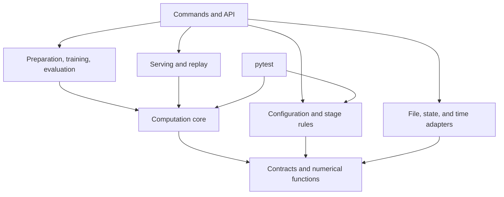

# Architecture of the Coveo session-based recommender

English | [Русский](/documents/architecture.md)

Version: 0.28. Date: October 11, 2026. The workflow from Coveo preparation to a local API and D evaluation under `observed_purchases_v1` is implemented. `post_D` is recorded with `S_offline=insufficient`; telemetry completeness is unknown. After comparison with a trained 370-candidate variant on C_select, the main 300-candidate GCS+Rk was retained. The Э6-01–Э6-05 demo has passed acceptance checks; production Э6 and Э8–Э10 are deferred. The local service is described in §6 and the batch workflow in §§11–14; results and limitations are in the [README](/README.md).

## 1. Basis and scope

Basis: [implementation specification 1.7](/documents/en/implementation_spec.md), [mathematical specification 2.10](/documents/en/math/coveo_session_recommender_math.tex), and [run manifest template 2.10](/documents/math/coveo_session_recommender_run_manifest.template.json). Source hashes are in [§19 of the implementation specification](/documents/en/implementation_spec.md#19-source-version); tasks and acceptance criteria are in the [development plan](/documents/en/development_plan.md). Requirement precedence is defined in the implementation specification's introduction. Boundaries and decisions are in §§2–9, the existing batch workflow in §§10–14, and the local service in §6.

The main local workflow is data → GCS+Rk → `C_smoke` report → fixed policy and plan → final D evaluation. Selection on `C_select` is optional for the first fixed model. E is reserved, and calibration is disabled. The Э6 service is a separate branch: its readiness and load acceptance neither authorize nor block the local Э7 evaluation. Formulas, parameters, and checks remain in the implementation and mathematical specifications.

For a new small run, [verification/reproduce.py](/src/coveo_recsys/verification/reproduce.py) creates configurations for individual commands, checks published rows directly, and prepares admission records from current checks and JUnit results. The helper does not replace computation commands or use previous `runs/`. Standard validators and period restrictions still apply. The small workflow was verified on Coveo using a separate non-editable installation; commands, results, and limitations are in the [guide](/documents/en/reproduction.md#full-computation-workflow).

## 2. Main decisions

- One Python package with separate commands and an API: computations are reused in preparation, training, and serving.
- Pure functions and adapters for input, storage, and time: algorithms can be tested without HTTP or a database.
- Typed internal records and external data schemas: invalid input is detected before computation.
- Shared state, source, and feature computation: training and serving use the same transformations.
- Immutable artifacts with dependencies: input or code changes are detected before reusing results.

Boundaries of existing and planned modules are defined in §3. The local workflow implements only the computations, input handling, and evaluation it needs; service adapters, monitoring, and A/B testing belong to their respective stages.

## 3. Module boundaries and dependencies

| Module | Responsibility |
|---|---|
| `contracts`, `numerics` | Records, units, statuses, ID ordering, and verifiable arithmetic. No dependencies on other modules. |
| `data` | CSV reading, canonicalization, time, scheduling, and assignment of whole sessions to periods. Reading is separate from transformations. |
| `state` | Pure `StateReducer`, available prefix, intake, and memory/file adapters. The production PostgreSQL adapter is not yet implemented. |
| `targets` | Recorded future purchases, candidate labels, and sessions with nonempty targets for training and evaluation. Request serving cannot access them. |
| `historical` | Catalog, graph, statistics, and vector construction. The package loader does not import the builder. |
| `retrieval` | Sources, exact scores, quotas, union, provenance, and fallback. Uses neither labels nor the ranker. |
| `features` | `FeatureEngine` under a pinned schema; uses shared scores from `retrieval`. The reverse dependency `retrieval → features` is forbidden. |
| `ranking` | Separate ranker training and inference. Inference receives prepared features and a compatible model, without reading training tables. Scores are not purchase probabilities. |
| `serving` | Recommendation pipeline and request coordination: API, deadlines, source availability, branch selection, and mandatory persistence. Transport is separate from computation. |
| `explanations` | Explanations based on the selected branch's computational evidence and package templates. Public output is separate from diagnostics. |
| `evaluation`, `experiments` | Session metrics and intervals; separately, A/B assignments and analysis. |
| `config`, `artifacts` | Configuration and stage admission; artifact storage and compatibility. |
| `verification` | Identifies executed code. Tests run through standard `pytest`; mappings of requirement IDs to tests are stored as data. |
| `monitoring`, `reporting` | Monitoring, protective actions, and reports from saved measurements. |
| `cli`, `extensions` | Workflow assembly; extension integration through declared interfaces and configuration. |

An arrow points to a dependency. The core includes the pure parts of data processing, state, retrieval, features, models, and explanations.

Adapters are injected through interfaces. The core does not import HTTP, database clients, `cli`, or the process clock. Stage validation reads artifact and result information but does not run training or tests.

A workflow in `cli` or the API passes a canonical block to `StateReducer`, then passes the prefix to scheduling functions; there is no `data → state` dependency. Model inference does not import training. The service has no access to future-target stores.

Basis: [implementation specification §§2.1–2.3](/documents/en/implementation_spec.md#2-architecture-and-general-requirements), [§14](/documents/en/implementation_spec.md#14-commands-and-pipeline-behavior); `sec:operations-features`, `sec:eval-maturity`.

## 4. Main contracts

Fields and signatures are defined in [§3.2](/documents/en/implementation_spec.md#32-logical-structures) and [§2.3](/documents/en/implementation_spec.md#23-main-core-interfaces) of the implementation specification. Additional decisions:

| Contract | Flow and restrictions |
|---|---|
| `CanonicalBlock` | Canonicalization → state and preparation. A complete simultaneous group with multiplicities, search-ineligibility reasons, and provenance; completeness of a historical group does not replace confirmation of a live envelope. |
| `PrefixSnapshot`, `PreparedRequest`, `RequestContext` | State → scheduling, retrieval, and features. A prepared request does not require a catalog that has not yet been built. `RequestContext` adds its hash at use time. A current record containing later events does not replace a snapshot; the future request count and outcome are absent from the context. |
| `TargetRecord`, `SupervisionRecord` | Target and weight preparation → training/evaluation. A target contains all distinct SKUs of recorded purchases within the defined window; an empty target does not confirm the absence of a purchase. Separate datasets are joined to features by `request_id` only in a batch workflow. |
| `HistoricalPackage` | Builder → retrieval and features. An A_G package without a ranker, sufficient to construct the B table. |
| Source result, `CandidateResult` | Sources → union, features, and explanations. Post-quota list, measurable score, rank, availability, and supporting evidence are stored separately; an unmeasured list is not considered empty. |
| `FeatureBatch` | Feature computation → ranker. SKU/column order and schema hash are checked with the model; labels and weights are stored separately. |
| `TrainingTable`, `RankerModel` | The table stores the matrix, labels, and ordered group sizes; the model stores the loaded LightGBM and compatibility summary. Inference uses only the model, `FeatureBatch`, and catalog hash. |
| Recommendation package | Artifact store → request. Contents follow §10.4 of the implementation specification; no calibrator or historical purchase-frequency feature. |
| `StateTransition` | `StateReducer` → workflow: a pure prefix-change result, not an acceptance acknowledgment or storage operation. The reducer contract is unchanged. |
| `StoredSession`, `BlockReceipt`, `Acceptance` | Intake → `StateStore`: log, snapshot, completeness, and receipts keyed by `(source_namespace, session_id)`. The CAS revision of `StoredSession` does not replace the prefix version; the workflow receives the atomic-write result. |
| `execution_context`, `RequestResult` | Coordinator → pipeline and accounting. Remaining time and source availability are explicit; selected branch, candidates, and delivery are recorded separately. |

Errors in required inputs, missing modalities, and internal nonfinite values are reported with distinct reasons. Early records are defined in `src/coveo_recsys/contracts/`; targets and weights are in `contracts.training` and are not imported by serving contracts.

## 5. Data flow during preparation, training, and evaluation

1. All published rows of a selected session → canonical blocks → one request after the first eligible detail block before a recorded purchase → calendar eligibility, periods, and subsampling. Targets are stored separately; future purchases do not affect request timing or ID selection.
2. All retained A_G sessions, with and without a recorded purchase → `HistoricalPackage`. Later periods do not extend the package; A_N in the baseline and E are reserved. Reading all published rows does not establish telemetry completeness.
3. First B requests → shared retrieval → `FeatureEngine` → target and weight join → ranker training on sessions with nonempty recorded targets. Target-based selection is not passed into candidates or features. Sessions without targets remain available for resource and failure measurements.
4. Trained ranker → package for subsequent requests. Historical purchase frequency is excluded from the feature schema; recorded-purchase counters and A_G popularity are retained.
5. `post_training` → `ideal_deterministic` on C_smoke → recorded-target join → Hit@20 among sessions with nonempty targets → reports with counts of all retained and positive sessions. Targets outside the catalog and refusals remain in the denominator.
6. Fixed model and plan → final D evaluation; C_select is needed only for selection. Before D, a no-metadata variant with its own features and ranker is mandatory. Precision thresholds are fractions; the result does not estimate purchase probability or causal purchase lift.

Format checks of closed periods are permitted separately from access to outcomes and quality metrics. Local data-reading paths enforce this separation; production permissions and auditing belong to Э6.

Basis: [implementation specification §§5–9](/documents/en/implementation_spec.md#5-preparing-events-requests-and-targets), [§14](/documents/en/implementation_spec.md#14-commands-and-pipeline-behavior); `sec:eval-periods`, `sec:eval-stages`, `sec:metadata-sensitivity`.

## 6. Data flow during serving

Э6-01–Э6-05 passed acceptance checks as a local demo under the updated specification; four scenarios passed on the prepared package and model. Results and limitations are in the [README](/README.md#example-recommendations). [serve](/src/coveo_recsys/cli/serving.py) starts a single API process on the local interface with the `local_checksum_only` profile and shared Э3–Э4 algorithms. `load` remains a stub; production serving, load testing, and a pilot have not passed acceptance checks.

Agreed demo scope: one overall timeout of 1000 ms under [§10.5](/documents/en/implementation_spec.md#105-response-deadline-and-branch-selection), with no normative per-stage deadlines or CPU-core tuning. Configuration passes `timeout_ms` and `reserve_ms` to the HTTP protocol and coordinator. Intake, state, and computation use one absolute deadline with a 100 ms reserve; persistence and response delivery use the overall deadline. The trace stores the actual timeout. Production Э6-06–Э6-11 is optional for the portfolio. Retry, eligibility, and late-completion checks are retained.

Local service contracts:

- [IntakeService](/src/coveo_recsys/state/service.py) binds the sender to `source_namespace`; the state key is `(source_namespace, session_id)`. The CAS revision of `StoredSession` is separate from the reconstructed prefix version. Events, receipts, and markers are published together; transport and canonical block IDs differ.
- Quarantine stores at most 1 MiB of UTF-8 text from rejected envelopes per session. On overflow, the new payload is not retained, but gap reasons and incompleteness remain; accepted events are not deleted.
- The first request is pinned in a separate log by session, idempotency key, trigger block, and two timestamps. A retry does not recompute the response. An unfinished request is not re-executed after restart.
- The [package loader](/src/coveo_recsys/serving/package.py) binds the completed historical package, model, schema, retrieval parameters, and templates while preserving producer hashes. Size limits are checked before loading; hashing proceeds in chunks with budget checks. All release metadata is loaded once; SKUs outside A_G do not extend the candidate catalog.
- [TimedH11Protocol](/src/coveo_recsys/serving/protocol.py) records `perf_counter` at the first byte before ASGI, preserving the timing of fragmented and pipelined requests. The coordinator uses the original deadline and a bounded [pure-computation pool](/src/coveo_recsys/serving/runtime.py); late computation does not publish a result. A deadline check before an atomic write does not make the system call interruptible. The log records branch selection and the final outcome; a missing verified snapshot is not replaced by empty history.
- Test adapters use memory or a single bounded JSON snapshot for file replay. They are not intended for multiple processes. PostgreSQL was chosen for Э6-06: a transaction and [row lock](https://www.postgresql.org/docs/current/explicit-locking.html#LOCKING-ROWS) can bind the state version, events, and receipt without a separate cache. The adapter, deployment, and database recovery are deferred.

1. The adapter validates the sender, limits, complete `sealed_block_v1`, and retries. Canonicalization and `StateReducer` compute the transition; storage acknowledges it atomically. Server acceptance time becomes the availability time of new events.
2. The workflow checks scheduling and idempotency, then obtains a `PrefixSnapshot` and compatible package. In a combined route, a_q is recorded after atomic block acceptance; the overall deadline starts at the first byte.
3. The pipeline prepares fallback, then performs retrieval, feature computation, and ranking within the remaining time. The coordinator passes a deadline check into `FeatureEngine`: computation stops between candidates and before the model call, without a partial feature batch. Operation inputs are pinned; switching to fallback does not change them. The pool slot is held until computation actually finishes. The coordinator chooses the branch; prefix and package remain bound to the request.
4. Explanations, mandatory persistence, and the public response complete the request. The log receives the same validated immutable records, checks their relationships, and serializes them once; log reading retains strict byte-level validation. Selected-branch candidates, delivery, and reasons are recorded. A response failure does not undo accepted events.

If delivery fails after branch selection, that branch's candidates are retained and the delivered list is empty. Before a completed branch is selected, both sets are empty. Fallback uses its own provenance and explanations, without the main ranker.

File replay uses the same `StateReducer`. [execution_trace](/src/coveo_recsys/serving/trace.py) validates recorded versions, availability, branch, and delivery; replay does not replace execution conditions with `ideal_deterministic` or reconstruct a missing trace. Э6-06–Э6-11 have not started; signing, production permissions, database recovery, and load acceptance remain separate tasks.

Basis: [implementation specification §10](/documents/en/implementation_spec.md#10-service-state-and-versions), [§9.3](/documents/en/implementation_spec.md#93-replay-mode); `sec:ops-transport-block`, `sec:ops-state-storage`, `sec:ops-replay-trace`, `sec:ops-deadlines`.

## 7. Artifact versions and dependencies

The run directory follows [§3.3](/documents/en/implementation_spec.md#33-run-directory). The first storage implementation uses local files: Parquet for tables and arrays with explicit types, shapes, and ID order for matrices. Libraries and codecs are pinned in Э0.

| Identifier | Purpose |
|---|---|
| Schema version | Rules for reading a structure. |
| Artifact SHA-256 | Hash of exact bytes; the descriptor records input, configuration, and code dependencies. |
| `run_id`, `config_id` | Run and registered variant; not substitutes for hash checks. |
| `package_id` | Identifier of immutable package contents. |
| State and prefix versions | Atomic updates and snapshot reconstruction. The cache key also includes t_q and the package. |
| Run manifest | One file with pinned inputs, code, settings, and plans; computation and test results are stored separately. |

Inputs, code, schemas, and settings are pinned before computation; evaluation plans are fixed before access to the corresponding evaluation data. Separate results refer to the run, its settings, and verified inputs. Per-stage manifest snapshots, separate manifest checksum files, and a universal artifact registry are not mandatory. Run results are excluded from the code-hashing scope.

Publication: intermediate write → validation → immutable file. Reuse requires matching input hashes, configuration, and code.

| Change | Rebuilds and repeated checks |
|---|---|
| Canonicalization, scheduling, periods, or session selection | Affected datasets, historical package, features, models, and evaluations. |
| Historical package, retrieval, encoder, quotas, or feature schema | B candidates and features, ranker, package, and affected checks. |
| Ranker | Package, recommendations, and evaluations. |
| Explanation templates | Package, EXPL01, and affected serving tests; no ranker retraining. |
| Report presentation | Human-readable report from previous machine-readable results. |

Build time differs from publication time. A request selects the latest compatible publication strictly before t_q, not a_q, and pins it until completion. A state-schema change requires a verified migration or reconstruction.

Packages load without executing serialized code, with path, size, type, and compatibility checks. Production serving requires signatures verified with a separately trusted key, owners, access control, and verifiable deletion of data, state, logs, and copies under defined retention periods. These requirements belong to the deferred production profile, not the local demo. A hash cannot reproduce a deleted input.

Basis: [implementation specification §§10.3–10.4](/documents/en/implementation_spec.md#103-state-and-transitions), [§11.2](/documents/en/implementation_spec.md#112-access-and-retention); `sec:eval-snapshots`, `sec:ops-security`, `sec:freshness-publication`.

## 8. Configuration and acceptance

Manifest validation: JSON Schema → semantic relationships → stage conditions and artifacts. Modules receive validated configuration for their own part, not a shared mutable JSON object.

`config` validates fields and results required at the current step, and verifies that pinned plans have not changed. A manifest flag alone does not prove that a check passed or a plan was fixed.

`manifest init` creates `manifest.json` in the run directory. `manifest validate` accepts externally pinned plan hashes through `--plan-reference NAME=SHA256`: `before_C_select`, `before_D`, and `before_AB` by their respective deadlines. `--operation evaluate` checks evaluation admission, including B12, but does not compute results; future commands refuse execution until implemented.

Checks run through `pytest`; requirement IDs map to tests and their results. Reference implementations are independent of the functions under test. Per-test hashes, snapshots, and advance registration as separate artifacts are not mandatory. Parts of B03, B05, B10, and X02 are tracked separately; the status of an entire ID depends on all parts applicable by its deadline. Test, system, and metric statuses are stored separately. B09 checks that purchase frequency is absent; B11 checks that calibration is disabled and E is unused.

Platform-specific skips follow [§15.1](/documents/en/implementation_spec.md#151-general-procedure): only skips caused by the known `WinError 1314` in the listed Windows symbolic-link tests are allowed for local B/C_smoke admission. Original `skipped` results remain separate from passes; path protections stay in the code and are tested on Ubuntu.

Code acceptance on synthetic data and real-data `preflight` are separated in [Э1-10 of the plan](/documents/en/development_plan.md#э1-10-admission-of-the-first-actual-run). Period access order and checks before C_smoke are in [§5 of the plan](/documents/en/development_plan.md#5-run-checkpoints). Half-width in fractions, planned variance, dependence assumptions and multiplier, and pilot provenance are justified after training using permitted C_smoke, then fixed with the grid and blocks before opening D (`sec:eval-precision`, `sec:eval-time-block`). These parameters are not required for `preflight` or the first model; verified data, code, schema, and admission evidence remain mandatory.

Basis: [implementation specification §4](/documents/en/implementation_spec.md#4-run-manifest-and-stage-control), [§15](/documents/en/implementation_spec.md#15-testing-and-traceability), [§17.2](/documents/en/implementation_spec.md#172-separate-decisions); `app:run-manifest`, `app:run-stages`, `app:tests-normative`, `sec:acceptance`.

## 9. Decisions as implementation progresses

| Decision | Deadline and result |
|---|---|
| Environment | Э0: CPython 3.11.9; dependencies and hashes in `uv.lock`, package contents in `pyproject.toml`. The neural profile is installed separately. |
| Actual inputs | A_G, B, C_smoke, and C_select accepted at 50,000 sessions each; D at 60,000. Historical package and models retained. Telemetry completeness remains unknown. |
| Features | Layout of 93 columns and transformations pinned in the [Э3 schema](/configs/feature_schema.json); `FeatureBatch` stores its hash. Real-data `preflight`, B features, and training are complete; report checks do not require their recomputation. |
| Evaluation plan | By the deadlines in §18: dates, volumes, grid, and assumptions based on permitted early data, without D results. |
| Production state store | PostgreSQL chosen; adapter and transaction/recovery checks belong to Э6-06. Implemented memory/file test adapters are described in §6. |
| Load and publication | Before tests: processes, threads, and memory measurement; before the production profile: trusted keys, owners, and retention periods. |
| Extensions | Э8–Э9 after baseline diagnostics: a registered question, separate artifacts, and checks. |
| Production A/B | Э10: protocol, separate accounting of assignments/exposures/outcomes, operational admission, and owners. |

Deadlines follow [§18 of the implementation specification](/documents/en/implementation_spec.md#18-decisions-required-before-the-corresponding-stages). Decisions and their rationale are recorded here; progress and results belong in the development plan.

## 10. Current implementation

### 10.1. Contracts and storage

- Immutable `dataclass` records with nested tuples: preparation contracts, `CandidateResult`, `SourceEvidence`, and `SupervisionRecord` use version 3; events and other unchanged records use version 2. In Э4 only the `SupervisionRecord` version changed: one request per session, weight 1, and protocol-defined pair weights. The JSON codec preserves int64, original UTF-8 IDs, and `null`; unknown fields and versions are rejected. Schemas are derived from types; constructors validate semantic constraints.
- Local publication uses a temporary file on the same volume and validation without overwriting completed results. A final file marks the dataset as ready after checks: §10.3 for preparation and §11.2 for the historical package.
- Matrices use NPY without objects or `pickle`. Shared preparation Parquet tables use `preparation_tables_v1`: `session_id: string` and `record_json: binary` containing a strict record envelope. Sessions are ordered by UTF-8 ID; chunked reading returns a whole session even across chunk boundaries. Э3 reuses this format for candidates and `FeatureBatch` (§12).
- The code hash uses an explicit inventory of sources, tests, schemas, configurations, dependencies, and packaging rules in `.gitignore`. Normative-document hashes are stored separately; editorial documentation changes do not change the code hash. `/data/` excludes only root-level raw data; `src/coveo_recsys/data/` modules are included in Git and the wheel. Package contents are checked through a clean installation outside the source directory.

`coveo-recsys environment` records versions, the Python build, compiler, and BLAS of the development environment; the load-test host is measured separately. The build tool is pinned with the libraries; the base installation excludes PyTorch.

### 10.2. Data preparation

Preparation implements one first request, calendar eligibility, and recorded targets under [§5.3](/documents/en/implementation_spec.md#53-recorded-targets-and-calendar-admission). Empty targets have unknown status; telemetry completeness is not asserted. The purchase cohort has been removed.

- `RawEvent.transport_id` is a confirmed delivery ID; a technical `event_id` without it does not prove a retry. The session key includes the source namespace. Row references retain the exact CSV hash: row reordering changes provenance, not the semantic result.
- Two-pass external sorting checks repeated deliveries and forms complete simultaneous blocks without assuming input CSV order. Chunk and group limits are explicit; exceeding them causes refusal, not truncation.
- A late block requires recomputing `reduce_state` from the full log. Tail limits do not remove the beginning of history, full counters, or the last detail group.
- The [synthetic profile](/configs/synthetic_csv.json) and [its plan](/configs/synthetic_preparation.json) remain for tests. Actual reading uses the [Coveo profile](/configs/coveo_supply_v1.json), `data/supply.py` rules, and shared canonicalization. `PreparationPlan` is separate from the run manifest: periods, sample sizes, seed, and budgets are fixed before outcomes are examined.
- The A_G sample size is pinned in the [real-data plan](/configs/coveo_preparation.json). A full pass over both CSV files aggregates first detail/purchase, last event, and row count into a compact temporary SQLite table. Eligible sessions with the smallest normative hashes are selected. Memory holds a bounded cache, a chunk, and selected IDs; the temporary database does not become a new project store.
- All browsing and search rows are reread for selected IDs. The run directory stores shared `canonical/<period>.parquet`, `preparation/sessions.parquet`, `datasets/<period>/prefixes.parquet`, and separate `datasets/<period>/targets.parquet`. Provenance and original row counts are checked against selection; the late tail is not cut off. Real A_G/B/C_smoke/C_select/D were prepared with separate admission; C_select requires `pre_selection`, D requires `pre_D`. A_N/E remain closed.
- `data inspect-supply` and `data inspect` validate the release. `data prepare` checks hashes, sizes, and headers against the verified profile without repeating the full release vector audit; selected events undergo normal reading and canonicalization checks. Original CSV files are not copied into `.objects/`.
- Static `validate_sealed_block` validates exact event-array bytes, fields, and time. Passing it is not a receipt: local `IntakeService` separately validates the sender, retries, and limits, then atomically saves events and a receipt (§6).

### 10.3. Reuse, checks, and access

One `reports/preparation.json` contains the format version, code and inputs, exact `profile_json` and `plan_json` texts, `sampled` selection, summary, measurements, and SHA-256 hashes, sizes, and row counts of final tables. It is published with status `completed` after input, table, and resource-limit checks. Preparation has no per-session files, descriptors, object copies, or per-step file log.

Until completion, `preparation/identity.json` pins code, inputs, and settings; it is removed once the summary is published. Interruption may leave this file and completed shared tables, but not a completed dataset. Repeating an unfinished pass recomputes data and compares already written tables, without replacing a different result. For completed datasets, code, inputs, settings, and table checksums are validated. Resuming at the last CSV row is unsupported; temporary disk use includes SQLite, sorting, and intermediate publication files. Full Coveo volume requires a separate resource measurement.

`DatasetAccess` streams whole sessions and validates reading purpose, period, type, schema, `synthetic/actual` scope, provenance, and dataset admission. The selected table's checksum is checked before and after reading. Consumers receive only permitted data; C_select and D require separate admission checks (§14). Diagnostic data, closed periods, and targets supplied instead of prefixes are rejected. A callback can report a read attempt to the caller without a separate file. The owner of local files has direct access; production permissions belong to Э6.

## 11. Historical package design: Э2

`historical build`, computation branches, publication, and independent package loading are implemented. This section describes existing code; Coveo execution and final acceptance are tracked separately in the [Э2 plan](/documents/en/development_plan.md#41-э2-historical-package). This command does not perform `preflight`.

### 11.1. Inputs, modules, and contracts

The build uses all published events of selected A_G sessions that passed calendar eligibility, not truncated request histories or only purchasing sessions. It additionally checks `t_last_obs + g < b_A_G`; this is a tail restriction, not proof of session closure. The catalog is defined by events under `eq:request-catalog`, not metadata availability or views. Preparation and the `data/historical.py` adapter share eligibility checks; `historical` computation modules receive validated input.

Contracts reside in [contracts/historical.py](/src/coveo_recsys/contracts/historical.py) and do not import the builder:

| Contract | Contents and boundary |
|---|---|
| `HistoricalInput` | `iter_sessions()` repeatedly yields complete tuples of `CanonicalBlock`; session count, snapshot boundary, ID namespace, scope, and pinned preparation hashes are passed alongside them. The adapter checks row completeness; telemetry completeness remains unknown. |
| `HistoricalConfig` | Snapshot time, computation parameters, UTF-8 order, package version, and resource limits. Settings are pinned in [coveo_historical.json](/configs/coveo_historical.json); synthetic input is not represented as real-data admission. |
| `MetadataSource` | Pinned metadata release, dimensions, and space provenance. The reading schema and query/text compatibility evidence are explicit. |
| `HistoricalPackage` | Catalog, graphs, statistics, modalities, snapshot boundary, input hashes, and part paths. `metadata_contract` retains space dimensions, the basis for query/text compatibility, and unknown historical metadata availability. Contains no model, B targets, or later-period outcomes. |

`DatasetAccess` serves prefixes and targets; its permissions are not extended. [data/historical.py](/src/coveo_recsys/data/historical.py) reads shared A_G and registry tables in chunks, checks selected IDs and all published session rows, and repeats shared calendar eligibility only for A_G. Reads and refusals are passed to the calling workflow. The only permitted import from `contracts.training` is `SessionRecord` for the admission registry; the adapter neither imports `targets` nor reads target tables. Full-release schema validation remains a separate route.

Settings pin the preparation path and SHA-256 of `reports/preparation.json` with status `completed`; descriptors and a separate completion certificate are unnecessary. Each pass validates the summary and checksums of the tables it uses. The preparation producer's hash is retained as `preparation_code` and need not equal the Э2 builder's `source_sha256()`. Preparation remains immutable and is not copied into the new run.

| Module | Responsibility and permitted dependencies |
|---|---|
| `historical/catalog.py` | Catalog and shared row order; `contracts`, no CSV reading. |
| `historical/graph.py` | Session contributions and final sparse relations; `contracts`, `numerics`. |
| `historical/statistics.py` | View counts, recorded-purchase counts, and popularity over all accepted A_G sessions; no purchase frequency. Depends on `contracts`, `numerics`. |
| `historical/content.py` | Modalities, masks, ineligibility reasons, and dictionaries; `contracts`, shared normalization from `numerics`. |
| `historical/build.py` | `build_historical(admitted_A_G, metadata, config, *, work_dir, check_budget=None)` combines computations; it does not decide command admission. |
| `historical/load.py` | Validation and reading of a completed `HistoricalPackage`; `contracts`, `artifacts`. Imports neither the builder, `targets`, nor `cli`. |
| `data/metadata.py` | Chunked reading of selected SKUs from the pinned CSV under the supply profile; repeated hash and size checks. |
| `cli/historical.py` | `run_historical` checks inputs and budgets; `publish_package` publishes consistent parts through `LocalArtifactStore`. Reuse and reports also live here; computation rules remain in the modules above. |

Build flow: `verified A_G input → catalog → graph / statistics / modalities → consistency checks → package contents`. Once contracts and the catalog are fixed, the three middle branches are independent. The loader passes the package to `retrieval` and `features`; there are no reverse dependencies.

Metadata for SKUs outside I_G may be needed for an already observed unknown item in the prefix (`sec:model-content`). `MetadataSource.read` supports separate reading from the same pinned release without extending the catalog, historical counters, or A_G category dictionary. Supplied vectors retain the static-metadata caveat (`ass:static-content`).

### 11.2. Artifacts and versions

The package format is `historical_package_v1`, independent of preparation-record and manifest versions. Contents and reading checks are defined in [historical/load.py](/src/coveo_recsys/historical/load.py). The preparation protocol is an input dependency; a record version alone does not establish compatibility. Unknown versions and extra or missing parts are rejected.

All paths below are within `/runs/<run_id>/historical/`:

| Artifact | Representation and dependencies |
|---|---|
| `settings.json` | Exact build-settings bytes: pinned preparation, metadata path, and configuration. |
| `catalog.parquet` | `sku: string`, `row_index: int64`; unique original SKUs in UTF-8 order. Membership is determined only by accepted A_G. |
| `graph/<relation>/` | For `detail_detail`, `detail_add`, `detail_purchase`: `indptr.npy`, `indices.npy`, `weights.npy`, `probabilities.npy`, `support.npy`, `row_sums.npy`, `rho.npy`. Sparse rows, FP64/int64, no objects or `pickle`. `graph/summary.json` stores aggregation volumes. |
| `statistics.parquet`, `statistics_summary.json` | SKUs, session-level `detail_count`, `purchase_count`, and smoothed `popularity`; total accepted-session count stored separately. No purchase-frequency feature. |
| `content/<modality>/`, `dictionaries.json` | For `description` and `image`: `vectors.npy`, `mask.npy`, `reasons.json`. Separately, category dictionary, codes, ordinal price groups, and their masks. |
| `package.candidate.json`, `package.json` | Version, configuration, input and part-descriptor hashes, catalog size, `metadata_contract`. Array shapes and types are pinned in descriptors. `package.json` is the final package-readiness marker. |
| `build_report.json`, `executions/<id>.json` | Successful-build report and separate attempt records with reads, duration, memory, disk, and coverage. Measurements do not alter mathematical tables. |

All substantive parts are bound to the shared catalog descriptor. External inputs are pinned by hashes; local dependencies of the new store are pinned by part descriptors. The loader validates contents, provenance, code, settings, shapes, types, SKU order, and mathematical consistency of arrays.

After the parts are published, `package.candidate.json` is written and fully validated by the ordinary loader. Before `package.json`, code/settings immutability and resource budgets are checked again. Incomplete publication is not a completed package. After interruption between fully published parts, a repeat recomputes branches without rewriting compatible verified parts; internal sorting cannot be resumed. Interruption within publication of an individual part requires a new run directory: remnants are retained, and publication cannot be completed automatically. If `package.json` already exists, the command rechecks the input and all sessions, then loads the compatible package without computing branches. Versions and hashes follow [§7](/documents/en/architecture.md#7-artifact-versions-and-dependencies).

### 11.3. Cost and deferred decisions

The graph is built without an I_G×I_G matrix. Pairs are written in bounded sorted chunks and merged on disk with a bounded number of open files. After merging, the minimum eligible lag is taken per pair and session. Intermediate pair count, largest simultaneous group, buffer, reads/writes, and temporary disk are measured separately. Limits from [coveo_historical.json](/configs/coveo_historical.json) are checked by the graph branch and supplied `check_budget`; exceeding them causes refusal without truncating groups. Temporary files are removed on success and failure.

The computation uses FP64 and stable Э0 primitives. Underflow of a positive decay causes numerical refusal before support filtering; it does not become an absent pair. The initial τ_G is retained.

Inspection of the supplied data confirmed that search, description, and image vectors have 50 dimensions and the expected format; query/description compatibility is based on the publisher's statement, not equal dimensions. Historical metadata availability is unconfirmed. Historical-package cost is in the [reproduction guide](/documents/en/reproduction.md#measured-costs). The expanded A_G package is pinned under Э2-08; sparse purchase-link coverage remains a limitation. `preflight` is required before B features and training under the [plan](/documents/en/development_plan.md#э1-10-admission-of-the-first-actual-run).

Multiprocess construction, additional storage formats, and search indexes can be deferred: they are unnecessary for checking formulas and module boundaries. Exact candidates and features are described in §12, training in §13; signatures, production permissions, and concurrent publication belong to Э6.

## 12. Retrieval and features: Э3

[retrieval/scores.py](/src/coveo_recsys/retrieval/scores.py) binds a verified `HistoricalPackage` to `PreparedRequest`: `RetrievalIndex` is loaded once, and `bind_context` validates the catalog and temporal snapshot. `score_request` returns `QueryScores`; retrieval and `FeatureEngine` use the same scores and masks. Metadata for observed out-of-catalog SKUs is read as a bounded set from the pinned release and reused. The A_G catalog and dictionary are not extended.

`retrieve` returns exact post-quota lists from eight sources, merged provenance, and separate `fill` padding. Main-branch SKUs are ordered by UTF-8. `retrieve_fallback` independently builds fallback in recent-view and popularity order; its items are not added to the main set. `SourceEvidence` retains the relation used, supporting SKU, support count or search context, and metadata space. Public explanations are built separately in the service (§6).

[FeatureEngine](/src/coveo_recsys/features/engine.py) computes 93 [schema](/configs/feature_schema.json) columns: 92 numeric and Boolean columns, including masks, and one categorical column. It accepts only the main branch, checks candidate order and provenance, and returns `FeatureBatch` with the schema hash. The core reads no files, targets, or process clock.

The second profile is `graph_recent_popularity_no_provided_metadata`: [54 numeric and Boolean columns](/configs/feature_schema_no_metadata.json), no categorical column. `RetrievalIndex.config_id` determines which sources are computed; the `FeatureEngine` schema must match it. Retrieval and features do not access catalog metadata, unknown-SKU metadata, or search content; shared counters and duration of permitted events are retained. The A_G loader still checks the integrity of the entire package. The eight-source format is unchanged: disabled sources have zero quotas and empty lists but are not considered failed.

The experimental `gcs_rk_metadata370` profile retains the baseline's 93 columns and formulas but increases the description quota to 80, image quota to 60, and candidate limit to 370. It has a [separate schema](/configs/feature_schema_metadata370.json), recomputed B features, and its own model trained with the same recipe. Increased coverage on C_select did not improve Hit@20; the service retains the 300-candidate baseline profile.

[features build](/src/coveo_recsys/cli/features.py) processes B; other periods are forbidden. Scope comes from pinned inputs. The synthetic route is available for tests; actual data require full Э1-10 admission before tables are read (§13). The command saves shared `features/candidates.parquet`, `features/fallback.parquet`, and `features/values.parquet`; `reports/features.json`, containing inputs, schema, and checksums, is published last. An unfinished run pins inputs in `features/identity.json`; repeating it checks compatibility, without per-request files or source-dataset copies.

Э3-06 is complete: independent reference implementations, batch and sequential workflows, interruption, reuse, a non-editable wheel installation, and bounded use of the real package were checked. This workflow does not train a model, measure Coveo quality, or complete service check B14. Features for all 50,000 B requests were computed after Э1-10 admission; results are in the [reproduction guide](/documents/en/reproduction.md#measured-costs).

## 13. Training and inference: Э4

[ranking/table.py](/src/coveo_recsys/ranking/table.py) joins prepared main-branch candidates and features with separate targets. `TrainingTable` preserves group and SKU order, labels, sizes, schema, and statistics. Fallback is excluded; targets outside candidates do not add rows. Empty unknown targets are excluded from training; target-bearing sessions without candidates or pairs are counted in the summary. Row-count, memory, and disk limits are checked before allocating the matrix. [ranking/matrix.py](/src/coveo_recsys/ranking/matrix.py) validates schema, columns, and masks consistently in training and inference.

[ranking/objective.py](/src/coveo_recsys/ranking/objective.py) implements `session_lambdas_v1` and its Dataset binding; [ranking/train.py](/src/coveo_recsys/ranking/train.py) passes the callable to LightGBM 4.6.0 under the [pinned recipe](/configs/ranker_recipe.json). The summary contains actual trees, leaf sizes, library parameters, and the stopping reason. Formulas and numerical requirements are in [§8](/documents/en/implementation_spec.md#8-ranking).

[train ranker](/src/coveo_recsys/cli/training.py) reads whole B groups, validates resources and input bindings, trains, and publishes two files: the native model `models/ranker.txt` and final `reports/ranker.json` summary in `ranker_v1` format. The summary is published after validating the saved model and rechecking inputs. If there are no pairs, the result is `insufficient`, with no completed model. After interruption, the command starts over; preparation and the matrix are not copied into the model directory.

[ranking/load.py](/src/coveo_recsys/ranking/load.py) validates format, model hash, column names, actual tree count, and pinned dependencies. [ranking/predict.py](/src/coveo_recsys/ranking/predict.py) accepts `RankerModel`, `FeatureBatch`, and the catalog hash, returning up to 20 main-branch SKUs with raw scores. Loading and inference import neither training nor targets; fallback remains a separate branch.

[cli/admission.py](/src/coveo_recsys/cli/admission.py) binds both commands to existing `validate_manifest(..., "preflight", ...)` before actual B is read and again before publication. It checks current code, dependencies, derivatives, schema, parameters, periods, sampling, and original CSV files. `evidence.data` pins preparation-plan and report hashes; actual selected-session count is distinct from the requested limit. Older producer code for accepted A_G is allowed if its inputs and parameters match; mixing synthetic and actual datasets is forbidden.

`sensitivity metadata --step features|train` invokes the same functions for the second profile. It has separate schema, features, model, and admission bindings; its [recipe](/configs/ranker_recipe_no_metadata.json) differs only in an empty `categorical_feature`. The matrix supports zero categorical columns. The model summary retains `config_id`; older baseline summaries without it are read as `gcs_rk_v2_7`. The `features_v1`/`ranker_v1` formats are retained; the new profile is not added to serving or closed-period evaluation.

Э4-07 passed acceptance on synthetic datasets: independent derivatives and groups, actual LightGBM splits, saving, inference, reuse, interruption, and admission refusals. General checks and the workflow from a non-editable wheel installation passed. In Э4-08, the first Coveo model was trained and checked after separate Э1-10 admission; results are in the [reproduction guide](/documents/en/reproduction.md#measured-costs). A new consumer needs its own `post_training`; previous checks do not establish it automatically.

## 14. Local evaluation: Э5

[evaluation/replay.py](/src/coveo_recsys/evaluation/replay.py) applies existing retrieval, features, and model without targets or file access. P uses A_G popularity; R uses recent views padded by popularity. Branch and delivery are stored separately. [sensitivity.py](/src/coveo_recsys/evaluation/sensitivity.py) reconstructs set/multiset prefixes from available blocks with a single A_G; the model is not applied to the altered schema.

If reconstructed prefixes differ only in their semantics label, diagnostics reuse baseline candidates and features: unit multiplicities give the same weights. The separate diagnostic schema and compatibility checks are retained. Otherwise, full computation is performed.

[cli/replay.py](/src/coveo_recsys/cli/replay.py) loads shared dependencies once and processes whole sessions in chunks. It saves `ReplayRecord` in shared `replay/answers.parquet`; [reporting.py](/src/coveo_recsys/evaluation/reporting.py) then joins separate targets and writes `EvaluationRecord` to `replay/sessions.parquet`. The full C_smoke feature matrix is not stored. Metrics and calendar intervals are computed in separate pure modules; tables contain information for independent recomputation.

The three summaries and multiplicity diagnostics read the completed score table in one chunked pass. Each record retains its strictly parsed JSON for read-only reuse; it is neither serialized nor held in a shared cache. Detailed records for all sessions are not accumulated. IDs, compact scores, timestamps, and latencies are retained for exact duplicate, pair, and quantile checks; input and output-table hashes are checked before publication. Prepared item sets and WinAPI setup are reused; memory is measured at every budget check.

`reports/replay.json` in `replay_v1` format is published last, after input, table, and resource checks. It pins current consumer code and original producer identities for B, features, historical package, and model. Markdown is rendered from the same result. `report --run` validates completed tables without accessing raw data or the model. An unfinished computation is repeated in full; a completed compatible result is not overwritten.

C_smoke admission uses the existing `post_training` validator and, for intervals, `operation=evaluate`. Before preparation, the canonical preparation-plan hash, CSV profile, and completed model are checked; the future dataset need not exist yet. After preparation, the exact plan bytes and pinned report are checked. Evidence for a new consumer does not change producer code or require baseline retraining. Configuration contents are in [configs/README.md](/configs/README.md#настройки-оценки-э5).

Real C_smoke requires separate agreement on volume and resources. `ideal_deterministic` does not establish service behavior; `S_offline` remains `not_run` until D. Calibration, E, and the no-metadata variant are not used in this workflow.

### Final D evaluation

`evaluate` uses the same chunked workflow and `replay_v1` format. The no-metadata variant joins the three methods: its own retrieval, schema, and model, with a shared historical package, requests, and targets. D matrices are computed from prefixes, not taken from B. Targets are read after all responses are saved; the summary includes separate V/U/Hit, differences from the baseline, intervals, and variant costs.

[Admission](/src/coveo_recsys/cli/admission.py) checks `pre_D`, `operation=evaluate`, the external `before_D` reference, and both model bindings before reading the D summary or tables. `DatasetAccess` receives an active-admission check, not unconditional period permission. For one previously fixed baseline, the validator permits skipping C_select; final evaluation of a selected pair on a new period is not yet implemented.

`select` uses the same computation for two models on C_select: the original and `gcs_rk_metadata370`. Each loads its own schema, B features, and model. Before preparation, `pre_selection` and the external `before_C_select` reference are checked, binding both models, the session plan, and resources. After responses are saved, the rule in [§9.5](/documents/en/implementation_spec.md#95-selection-and-the-variant-without-metadata) is applied. Shared serialization and writing costs are measured separately from each model's computation; total runtime for both models is not presented as individual HTTP-request latency.

Configuration and input pinning are described in [configs/README.md](/configs/README.md#итоговая-оценка-d). Evaluation on 60,000 D sessions is complete; actual `post_D` is recorded with `S_offline=insufficient` because dependence assumptions are unsupported. Evidence and summaries were checked for consistency; statistical admission remains closed. The original `pre_D` manifest and computation report were not overwritten; the result is stored in `runs/coveo-d-plan-v2/manifest-post_D.json`. Metrics, losses, and limitations are in the [README](/README.md#measured-results).

Comparison of the original model and the 370-candidate variant on 50,000 C_select sessions is complete: `selection.status=passed`, with `gcs_rk_v2_7` selected. Variant features and training used the existing B; A_G and the main model were unchanged. This is exploratory selection after analyzing D, not independent confirmation of improvement. Comparison intervals have status `insufficient`.

### Published-report verification

In [Э5-09](/documents/en/development_plan.md#closing-э5-09-using-completed-results), the standard reader confirmed table integrity and agreement between JSON and Markdown. An independent chunked pass checked the full session population and denominator; main metrics and losses were recomputed only for nonempty targets. It used the existing reference implementation, not production evaluation. A small verification summary was saved separately in `runs/`. Preparation, training, and recommendation generation were not repeated.

Slices, sources, multiplicities, and intervals are not recomputed: they are retained in the report, and their algorithms are covered by tests. Compatible `replay` reuse is covered by integration testing; a separate actual repeat of the old run is unnecessary. Its identity and files remain unchanged. This check needs no new schemas, commands, admissions, or shared cache.

Reasons for statistical insufficiency are retained: technical acceptance does not establish statistical significance or business impact. The local Э6 service is described in §6; Э7 status is in the [plan](/documents/en/development_plan.md#7-current-status). D and the subsequent C_select investigation are complete; A_N/E were not opened. New research does not block publication and requires a separate plan; D has already been inspected and cannot support a new confirmatory conclusion.
